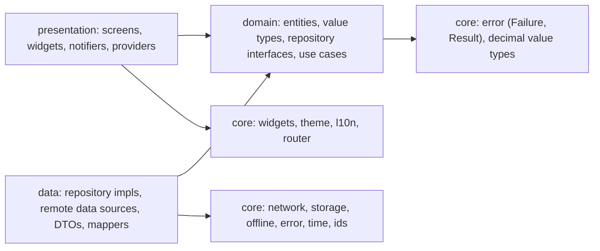
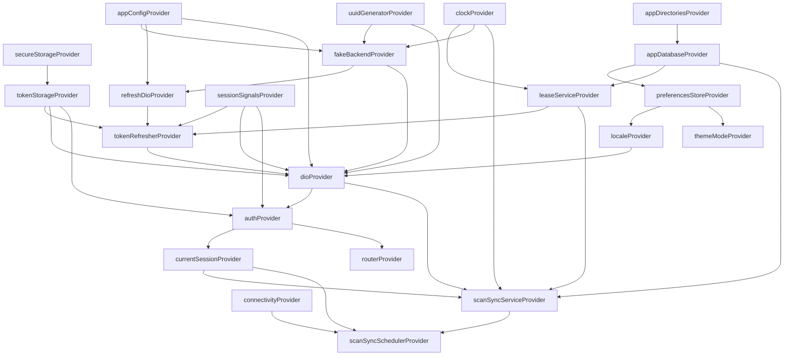
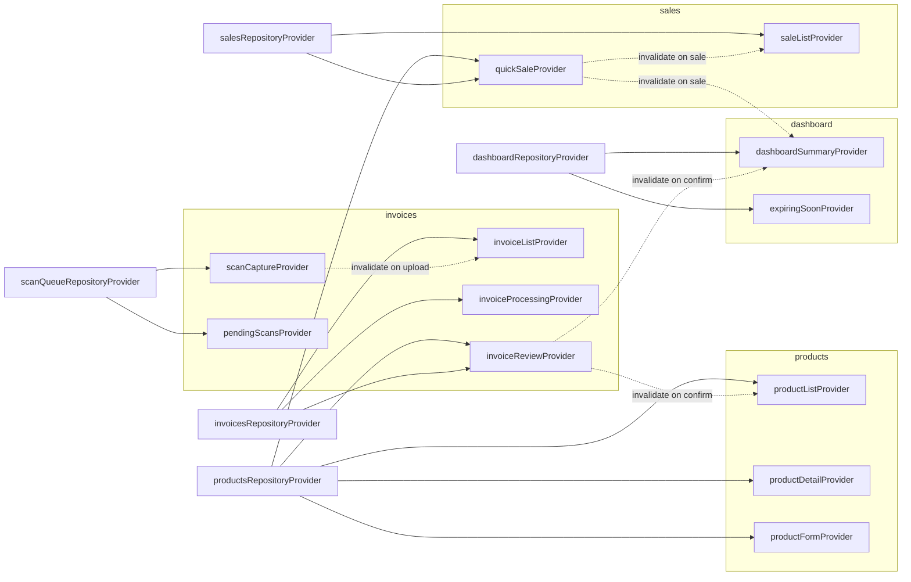
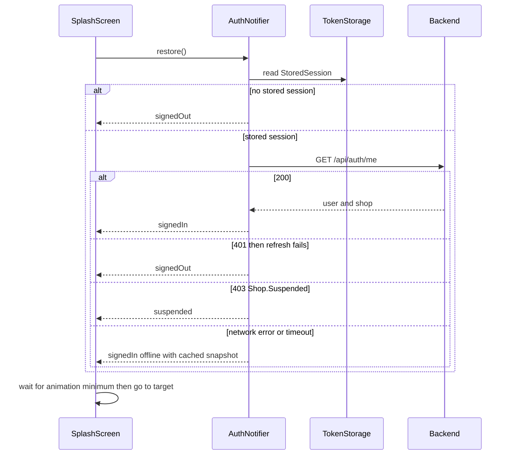
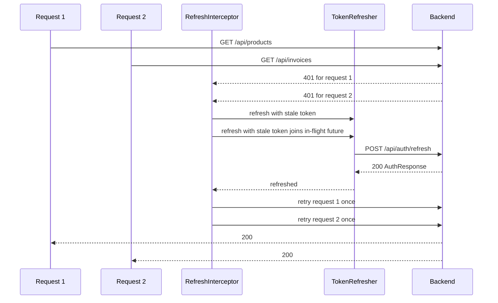
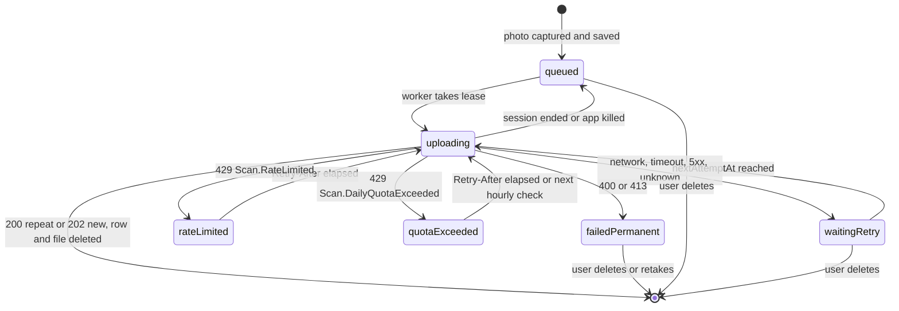

# Stockly mobile — Frontend design

Status: **Approved** (checkpoint 2, 2026-10-12; decisions in §15) · Contract: **v1.2** (`docs/api/contract.md`) · Toolchain: Flutter 3.47.7 stable, Dart 3.13.5 · Updated 2026-10-12

This document fixes the whole design of the Flutter app before any code is written. Implementation briefs for Sprints 3 and 4 reference its sections by number. Where this document and `AGENTS.md` or the contract disagree, `AGENTS.md` and the contract win and this document is a bug.

Contents:
0. Principles and rule map
1. Layers per feature
2. Riverpod provider graph
3. Routing (go_router)
4. Networking: Dio interceptors, refresh queue, `Failure` mapping
5. Decimal handling
6. Offline scan queue (and pending sales)
7. Theme
8. Localization and RTL
9. `AsyncStateView`
10. Splash
11. Screens for Sprints 3–4
12. Fake backend (running without the API)
13. Testing plan
14. Packages that need approval
15. Open questions

---

## 0. Principles and rule map

| Rule (AGENTS.md / brief §3) | Where it is applied in this design |
|---|---|
| 34. Four states via `AsyncStateView` | §9 (widget API), §11 (states of every screen), §13 (4 states × 2 languages tests) |
| 35. No hardcoded strings, colors, sizes, durations | §7 (`StocklyColors`, `StocklySpacing`, `StocklyRadii`, `StocklyDurations`, `StocklyTypography`), §8 (ARB keys, including every error code), §10 (`SplashTimings` tokens), §4.2 (network timeouts as named constants) |
| 36. `EdgeInsetsDirectional`, `AlignmentDirectional`, `start`/`end` | §8.5 (RTL rules), §10.3 (logo kept LTR with `Directionality`, still `AlignmentDirectional`), §13.3 (RTL widget assertions) |
| 37. Immutable state (freezed), no business logic in widgets | §1 (use cases own logic), §2 (every notifier state is a freezed class), §11 (state classes per screen) |
| 38. Tokens in `flutter_secure_storage` only, no API keys | §4.3 (`SecureTokenStorage`, one JSON blob), §4.7 (logging redaction), §12 (fake backend has no keys) |
| 39. Reduce motion shows the final frame | §7.6 (`StocklyMotion`), §10.4 (splash final frame) |
| Layering: presentation → domain → data, widgets never import Dio/data | §1.1 (import rules), §13.4 (import-rule test) |
| Repositories return `Result<T, Failure>`, never throw to the UI | §1.3 (`Result`), §4.6 (`safeApiCall`) |
| Money/quantities are `Decimal`, never `double` | §5 (value types `Money`, `Quantity`, `UnitFactor`, `MatchConfidence`) |
| Shop comes from the token, app never sends a shop id | §4 (no shop id in any request), §6.2 (local `shopId` column is only a local scope, never sent) |
| `clientRequestId` created once, reused on every retry | §6 (scans, Drift row is the source of the id), §6.8 (sales) |
| On 401 refresh once, retry once, shared refresh, failure signs out | §4.3 |
| Switch on `code`, never `title`/`detail` | §4.5 (`ApiErrorCode`), §8.4 (messages by code) |
| Never log tokens, passwords, full images | §4.7 |
| Only approved packages | §14 (approval table, each behind an interface) |

Global conventions used below:
- File names `snake_case`, one public widget per file, `very_good_analysis` with no ignores.
- Providers are **hand-written** (no `riverpod_generator`), Riverpod 3 API, so names follow the convention exactly: provider `<thing>Provider`, notifier `<Thing>Notifier`.
- Every notifier state and every entity is a `freezed` class (freezed 3 syntax: `@freezed abstract class X with _$X`, `@freezed sealed class` for unions).
- Time is read through `Clock` (`core/time/clock.dart`), never `DateTime.now()` directly, so tests control time.
- IDs are generated through `UuidGenerator` (`core/ids/uuid_generator.dart`).

---

## 1. Layers per feature

### 1.1 Dependency direction



Import rules (checked by a test, §13.4):
- `features/*/presentation/**` may import its own `domain/**`, `core/widgets`, `core/theme`, `core/router`, `l10n`, `core/error`. It **never** imports `package:dio`, `package:drift`, `features/*/data/**` or `core/network/**`. The single place that wires data into presentation is the feature's `presentation/providers/<feature>_providers.dart`, which imports the data layer only to build the repository provider (composition root per feature).
- `features/*/domain/**` imports only `core/error`, `core/decimal`, `core/time`, `freezed_annotation`, and other features' `domain/entities` when an entity is shared (for example `invoices/domain` uses `products/domain/entities/product_list_item.dart`).
- `features/*/data/**` imports `core/network`, `core/offline`, `core/storage`, its own `domain/**`.
- No feature imports another feature's `presentation` or `data`.

### 1.2 Folder template

Every feature except `splash` has the three layers from `docs/structure.md`:

```
lib/features/<feature>/
├── data/
│   ├── datasources/   <feature>_remote_data_source.dart   (Dio calls, returns DTOs, throws DioException)
│   ├── models/        *_dto.dart                          (freezed + json_serializable, decimal converters)
│   └── repositories/  <feature>_repository_impl.dart      (DTO → entity, safeApiCall → Result)
├── domain/
│   ├── entities/      *.dart                              (freezed, Decimal value types)
│   ├── repositories/  <feature>_repository.dart           (abstract interface class)
│   └── usecases/      *_use_case.dart                     (one public call(), one use case each)
└── presentation/
    ├── providers/     <feature>_providers.dart, *_notifier.dart, *_state.dart
    ├── screens/       *_screen.dart                       (one route = one screen)
    └── widgets/       *.dart                              (one public widget per file)
```

### 1.3 Shared core

```
lib/
├── main.dart                    # bootstrap(): WidgetsFlutterBinding, AppDirectories, ProviderScope(overrides, retry: noRetry)
├── app.dart                     # StocklyApp: MaterialApp.router (theme, darkTheme, themeMode, locale, delegates)
├── l10n/                        # app_ar.arb (template), app_en.arb; generated → lib/l10n/generated/ (git-ignored)
└── core/
    ├── config/      app_config.dart (AppConfig, BackendMode), network_timeouts.dart, limits.dart
    ├── decimal/     money.dart, quantity.dart, unit_factor.dart, match_confidence.dart,
    │                decimal_input_parser.dart, decimal_formatter.dart, decimal_json_converters.dart
    ├── error/       failure.dart (sealed Failure), api_error_code.dart, result.dart
    ├── ids/         uuid_generator.dart (UuidGenerator, PackageUuidGenerator over `uuid`)
    ├── logging/     app_logger.dart
    ├── pagination/  paged.dart, paged_state.dart
    ├── time/        clock.dart (Clock, SystemClock)
    ├── network/     dio_client.dart, correlation_id_interceptor.dart, accept_language_interceptor.dart,
    │                auth_header_interceptor.dart, refresh_interceptor.dart, shop_suspended_interceptor.dart,
    │                redacting_log_interceptor.dart, token_refresher.dart, error_mapper.dart,
    │                problem_details_dto.dart, safe_api_call.dart, request_extras.dart
    ├── fake_backend/ fake_backend_adapter.dart, fake_backend_state.dart, handlers/*, seed/*  (§12)
    ├── storage/     secure_token_storage.dart (TokenStorage), stored_session.dart, preferences_store.dart
    ├── offline/     app_database.dart, tables/*.dart, daos/*.dart, lease.dart,
    │                scan_sync_service.dart, scan_sync_scheduler.dart, background_sync_entrypoint.dart,
    │                backoff_policy.dart
    ├── media/       invoice_image_source.dart, image_compressor.dart, app_directories.dart (interfaces + impls, §14)
    ├── router/      app_router.dart, route_paths.dart, route_names.dart, auth_redirect.dart, router_refresh.dart
    ├── session/     session_signals.dart (SessionSignals: sessionEnded / shopSuspended stream)
    ├── theme/       tokens.dart, stockly_colors.dart, stockly_spacing.dart, stockly_radii.dart,
    │                stockly_durations.dart, stockly_typography.dart, app_theme.dart, stockly_motion.dart
    └── widgets/     async_state_view.dart, empty_state.dart, error_state.dart, loading_state.dart,
                     money_text.dart, quantity_text.dart, paged_list_view.dart, failure_message.dart,
                     offline_banner.dart, owner_only.dart
```

`Result`:

```dart
sealed class Result<T, F extends Failure> {
  const Result();
}
final class Ok<T, F extends Failure> extends Result<T, F> { const Ok(this.value); final T value; }
final class Err<T, F extends Failure> extends Result<T, F> { const Err(this.failure); final F failure; }
```

Repositories return `Future<Result<T, Failure>>`. Use cases return the same type. Notifiers turn `Err` into `AsyncError(failure, stackTrace)` or a failure field of their freezed state. Nothing above the data layer catches exceptions from Dio.

### 1.4 Classes per feature

**auth**

| Layer | File / class |
|---|---|
| data/datasources | `AuthRemoteDataSource` (`register`, `login`, `logout`, `me`). Refresh is not here; it lives in `core/network/token_refresher.dart` because interceptors need it. |
| data/models | `RegisterRequestDto`, `RegisterShopDto`, `LoginRequestDto`, `LogoutRequestDto`, `AuthResponseDto`, `UserDto`, `ShopMembershipDto`, `MeResponseDto` |
| data/repositories | `AuthRepositoryImpl` (saves `AuthResponse` to `TokenStorage`, maps DTOs) |
| domain/entities | `User`, `ShopMembership`, `Session` (user + shop + token expiries, no token strings), `ShopType`, `ShopStatus`, `ShopRole`, `AppLanguage`, `RegisterInput` |
| domain/repositories | `AuthRepository` (`register`, `login`, `restoreSession`, `logout`, `cachedSession`) |
| domain/usecases | `RegisterUseCase`, `LoginUseCase`, `RestoreSessionUseCase`, `LogoutUseCase` |
| presentation/providers | `authProvider` (`AuthNotifier`, state `AuthState`), `currentSessionProvider`, `loginFormProvider` (`LoginFormNotifier`), `registerFormProvider` (`RegisterFormNotifier`) |
| presentation/screens | `LoginScreen`, `RegisterScreen`, `ShopSuspendedScreen` |
| presentation/widgets | `PasswordField`, `ShopTypePicker`, `AuthHeader` |

`AuthState` (freezed union): `AuthState.unknown()`, `AuthState.signedOut({Failure? reason})`, `AuthState.signedIn(Session session, {required bool offline})`, `AuthState.suspended(Session session)`.

**products**

| Layer | File / class |
|---|---|
| data/datasources | `ProductsRemoteDataSource` (P1–P12) |
| data/models | `ProductListItemDto`, `ProductBaseUnitDto`, `ProductDetailDto`, `UnitDto`, `StockMovementDto`, `PagedResponseDto<T>`, `CreateProductRequestDto`, `UpdateProductRequestDto`, `UnitRequestDto`, `AdjustmentRequestDto`, `StockCountRequestDto`, `StockCountResponseDto`, `ProductLookupResponseDto` |
| data/repositories | `ProductsRepositoryImpl` |
| domain/entities | `ProductListItem`, `ProductBaseUnit`, `ProductDetail`, `ProductUnit`, `StockMovement`, `StockMovementReason`, `StockCountResult`, `ProductLookup`, `ProductQuery` (search, lowStock, includeArchived), `Paged<T>`, `ProductDraft`, `UnitDraft` |
| domain/repositories | `ProductsRepository` |
| domain/usecases | `GetProductsUseCase`, `GetProductUseCase`, `CreateProductUseCase`, `UpdateProductUseCase`, `ArchiveProductUseCase`, `AddUnitUseCase`, `UpdateUnitUseCase`, `DeleteUnitUseCase`, `AdjustStockUseCase`, `RecordStockCountUseCase`, `GetMovementsUseCase`, `LookupBarcodeUseCase` |
| presentation/providers | `productListProvider`, `productDetailProvider`, `productFormProvider`, `unitFormProvider`, `stockAdjustmentProvider`, `stockCountProvider`, `movementListProvider` (§2.3) |
| presentation/screens | `ProductListScreen`, `ProductDetailScreen`, `ProductFormScreen` (create and edit), `UnitFormScreen`, `StockAdjustmentScreen`, `StockCountScreen`, `MovementListScreen` |
| presentation/widgets | `ProductListTile`, `LowStockBadge`, `UnitListTile`, `MovementListTile`, `ProductSearchField`, `ProductFilterChips` |

`Paged<T>` is shared by every list, so it lives in `core/pagination/paged.dart` (not in a feature, which would couple features): `items`, `page`, `pageSize`, `totalCount`, `hasMore`.

**invoices**

| Layer | File / class |
|---|---|
| data/datasources | `InvoicesRemoteDataSource` (I1–I5), `PendingScansLocalDataSource` (Drift DAO wrapper) |
| data/models | `InvoiceListItemDto`, `InvoiceDetailDto`, `InvoiceItemDto`, `NewProductDto`, `UpdateInvoiceItemsRequestDto`, `UpdateInvoiceItemRequestDto` |
| data/repositories | `InvoicesRepositoryImpl`, `ScanQueueRepositoryImpl` |
| domain/entities | `InvoiceListItem`, `InvoiceDetail`, `InvoiceItem`, `NewProduct`, `InvoiceStatus`, `InvoiceWarning`, `InvoiceDraft`, `InvoiceLineDraft`, `LineProductChoice` (sealed: `ExistingProductChoice(productId, productUnitId)`, `NewProductChoice(NewProduct)`, `UnresolvedChoice`), `PendingScan`, `PendingScanStatus`, `ScanUploadOutcome`, `CapturedImage` |
| domain/repositories | `InvoicesRepository`, `ScanQueueRepository` |
| domain/usecases | `CaptureInvoiceUseCase` (compress + enqueue), `UploadPendingScanUseCase`, `DeletePendingScanUseCase`, `GetInvoicesUseCase`, `GetInvoiceUseCase`, `WatchInvoiceProcessingUseCase` (polling), `SaveInvoiceItemsUseCase`, `ConfirmInvoiceUseCase` |
| presentation/providers | `invoiceListProvider`, `invoiceDetailProvider`, `invoiceProcessingProvider`, `invoiceReviewProvider`, `scanCaptureProvider`, `pendingScansProvider`, `pendingScanCountProvider` |
| presentation/screens | `InvoiceListScreen`, `ScanCaptureScreen`, `ScanQueueScreen`, `InvoiceDetailScreen` (status router), `InvoiceProcessingView`, `InvoiceReviewScreen`, `InvoiceLineEditorScreen`, `InvoiceConfirmedView`, `InvoiceFailedView` |
| presentation/widgets | `InvoiceStatusChip`, `InvoiceWarningBanner`, `InvoiceLineTile`, `ProductPickerSheet`, `NewProductForm`, `PendingScanTile` |

**sales**

| Layer | File / class |
|---|---|
| data/datasources | `SalesRemoteDataSource` (S1–S3), `PendingSalesLocalDataSource` (Drift) |
| data/models | `CreateSaleRequestDto`, `CreateSaleItemRequestDto`, `SaleDto`, `SaleItemDto`, `SaleWarningDto`, `SaleListItemDto` |
| data/repositories | `SalesRepositoryImpl` |
| domain/entities | `Sale`, `SaleItem`, `SaleWarning`, `SaleListItem`, `CartLine`, `SaleSubmission` (`created` / `alreadyRecorded`), `SaleDateRange` |
| domain/repositories | `SalesRepository` |
| domain/usecases | `SubmitSaleUseCase`, `GetSalesUseCase`, `GetSaleUseCase` (barcode lookup reuses `LookupBarcodeUseCase` from products) |
| presentation/providers | `quickSaleProvider`, `saleListProvider`, `saleDetailProvider` |
| presentation/screens | `QuickSaleScreen`, `SaleListScreen`, `SaleDetailScreen` |
| presentation/widgets | `CartLineTile`, `BarcodeEntryField`, `PriceOverrideField`, `NegativeStockWarning`, `SaleTotalBar` |

**dashboard**

| Layer | File / class |
|---|---|
| data | `DashboardRemoteDataSource` (D1, D2), `DashboardSummaryDto`, `TodaySalesDto`, `ExpiringItemDto`, `DashboardRepositoryImpl` |
| domain | `DashboardSummary`, `TodaySales`, `ExpiringItem`, `DashboardRepository`, `GetDashboardSummaryUseCase`, `GetExpiringSoonUseCase` |
| presentation | `dashboardSummaryProvider`, `expiringSoonProvider`; `DashboardScreen`, `ExpiringSoonScreen`; widgets `SummaryCard`, `TodaySalesCard`, `ExpiringItemTile` |

The low-stock list is not a separate screen: it is `ProductListScreen` opened with the `lowStock` filter (P1 `lowStock=true`).

**settings**

| Layer | File / class |
|---|---|
| data | `PreferencesRepositoryImpl` (over `PreferencesStore`, Drift `preferences` table) |
| domain | `AppPreferences` (`LocalePreference`, `ThemePreference`), `PreferencesRepository`, `SetLocaleUseCase`, `SetThemeUseCase` |
| presentation | `SettingsScreen`; widgets `LanguageTile`, `ThemeTile`, `ShopInfoTile`, `LogoutTile`. Locale and theme state live in core providers (`localeProvider`, `themeModeProvider`) because `app.dart` needs them. |

**splash** (presentation only)

| Layer | File / class |
|---|---|
| presentation/providers | `splashProvider` (`SplashNotifier`, state `SplashState`: `animationDone`, `sessionResolved`, `target`) |
| presentation/screens | `SplashScreen` |
| presentation/widgets | `AnimatedStocklyMark`, `SplashWordmark`, `SplashLoadingDots` |

Splash has no data or domain layer: it calls `authProvider.notifier.restore()` (auth domain) and reads the result.

---

## 2. Riverpod provider graph

Riverpod 3 (`flutter_riverpod` 3.x). `ProviderScope(retry: (_, _) => null)` disables Riverpod 3 automatic retry globally: a `Failure` is a final answer and retry is an explicit user action (`ref.invalidate` from the error state's retry button).

### 2.1 Core graph



`dioProvider` reads the locale lazily (`() => ref.read(localeProvider).languageCode`) inside the interceptor, so a language change does not rebuild Dio or cancel requests. Interceptors never depend on `authProvider` (that would be a cycle `dio → auth → dio`): they publish to `SessionSignals`, and `AuthNotifier` listens.

### 2.2 Core providers

| Provider | Type | Depends on | Lifetime |
|---|---|---|---|
| `appConfigProvider` | `Provider<AppConfig>` | none (overridden in `bootstrap()` from `--dart-define`) | keepAlive |
| `clockProvider` | `Provider<Clock>` | none | keepAlive |
| `uuidGeneratorProvider` | `Provider<UuidGenerator>` | none | keepAlive |
| `appDirectoriesProvider` | `Provider<AppDirectories>` | none (overridden in `bootstrap()` after the directory lookup) | keepAlive |
| `secureStorageProvider` | `Provider<FlutterSecureStorage>` | none | keepAlive |
| `tokenStorageProvider` | `Provider<TokenStorage>` (`SecureTokenStorage`) | `secureStorageProvider` | keepAlive |
| `appDatabaseProvider` | `Provider<AppDatabase>` | `appDirectoriesProvider` | keepAlive, `onDispose` closes the DB |
| `preferencesStoreProvider` | `Provider<PreferencesStore>` | `appDatabaseProvider` | keepAlive |
| `localeProvider` | `NotifierProvider<LocaleNotifier, Locale>` | `preferencesStoreProvider` | keepAlive |
| `themeModeProvider` | `NotifierProvider<ThemeModeNotifier, ThemeMode>` | `preferencesStoreProvider` | keepAlive |
| `sessionSignalsProvider` | `Provider<SessionSignals>` | none | keepAlive, `onDispose` closes the stream |
| `leaseServiceProvider` | `Provider<LeaseService>` | `appDatabaseProvider`, `clockProvider` | keepAlive |
| `fakeBackendProvider` | `Provider<FakeBackendAdapter?>` | `appConfigProvider`, `clockProvider`, `uuidGeneratorProvider` | keepAlive; `null` when `BackendMode.real` |
| `refreshDioProvider` | `Provider<Dio>` (no auth interceptors) | `appConfigProvider`, `fakeBackendProvider` | keepAlive |
| `tokenRefresherProvider` | `Provider<TokenRefresher>` | `refreshDioProvider`, `tokenStorageProvider`, `sessionSignalsProvider`, `leaseServiceProvider` | keepAlive |
| `dioProvider` | `Provider<Dio>` | `appConfigProvider`, `fakeBackendProvider`, `tokenStorageProvider`, `tokenRefresherProvider`, `sessionSignalsProvider`, `localeProvider` (read), `uuidGeneratorProvider` | keepAlive |
| `authProvider` | `AsyncNotifierProvider<AuthNotifier, AuthState>` | auth use cases, `sessionSignalsProvider`, `localeProvider` | keepAlive |
| `currentSessionProvider` | `Provider<Session?>` | `authProvider` | keepAlive |
| `isOwnerProvider` | `Provider<bool>` | `currentSessionProvider` | keepAlive |
| `routerProvider` | `Provider<GoRouter>` | `authProvider` (through `RouterRefresh`, a `ChangeNotifier`) | keepAlive |
| `connectivityProvider` | `StreamProvider<bool>` (online or not) | none (`connectivity_plus`) | keepAlive |
| `scanSyncServiceProvider` | `Provider<ScanSyncService>` | `dioProvider`, `appDatabaseProvider`, `leaseServiceProvider`, `clockProvider`, `currentSessionProvider` | keepAlive |
| `scanSyncSchedulerProvider` | `Provider<ScanSyncScheduler>` | `connectivityProvider`, `scanSyncServiceProvider`, `currentSessionProvider` | keepAlive, started in `StocklyApp.initState` |

### 2.3 Feature providers

Repository and use-case providers are plain `Provider`s, keepAlive, one per class, named after the class (`productsRepositoryProvider`, `getProductsUseCaseProvider`, ...). They are listed once here, not per row:

- auth: `authRemoteDataSourceProvider`, `authRepositoryProvider`, `registerUseCaseProvider`, `loginUseCaseProvider`, `restoreSessionUseCaseProvider`, `logoutUseCaseProvider`
- products: `productsRemoteDataSourceProvider`, `productsRepositoryProvider`, one provider per use case in §1.4
- invoices: `invoicesRemoteDataSourceProvider`, `pendingScansLocalDataSourceProvider`, `invoicesRepositoryProvider`, `scanQueueRepositoryProvider`, `invoiceImageSourceProvider`, `imageCompressorProvider`, one provider per use case
- sales: `salesRemoteDataSourceProvider`, `pendingSalesLocalDataSourceProvider`, `salesRepositoryProvider`, one per use case
- dashboard: `dashboardRemoteDataSourceProvider`, `dashboardRepositoryProvider`, one per use case
- settings: `preferencesRepositoryProvider`, `setLocaleUseCaseProvider`, `setThemeUseCaseProvider`

State providers:

| Provider | Type | Depends on | Lifetime |
|---|---|---|---|
| `loginFormProvider` | `NotifierProvider.autoDispose<LoginFormNotifier, LoginFormState>` | `loginUseCaseProvider`, `authProvider` | autoDispose |
| `registerFormProvider` | `NotifierProvider.autoDispose<RegisterFormNotifier, RegisterFormState>` | `registerUseCaseProvider`, `authProvider`, `localeProvider` | autoDispose |
| `splashProvider` | `NotifierProvider.autoDispose<SplashNotifier, SplashState>` | `authProvider`, `clockProvider` | autoDispose |
| `productListProvider` | `AsyncNotifierProvider.autoDispose.family<ProductListNotifier, PagedState<ProductListItem>, ProductQuery>` | `getProductsUseCaseProvider` | autoDispose |
| `productDetailProvider` | `AsyncNotifierProvider.autoDispose.family<ProductDetailNotifier, ProductDetail, String>` | `getProductUseCaseProvider`, archive and unit use cases | autoDispose |
| `productFormProvider` | `NotifierProvider.autoDispose.family<ProductFormNotifier, ProductFormState, String?>` (null = create) | create/update/get use cases, `isOwnerProvider` | autoDispose |
| `unitFormProvider` | `NotifierProvider.autoDispose.family<UnitFormNotifier, UnitFormState, UnitFormArgs>` | add/update unit use cases | autoDispose |
| `stockAdjustmentProvider` | `NotifierProvider.autoDispose.family<StockAdjustmentNotifier, StockAdjustmentState, String>` | `adjustStockUseCaseProvider` | autoDispose |
| `stockCountProvider` | `NotifierProvider.autoDispose.family<StockCountNotifier, StockCountState, String>` | `recordStockCountUseCaseProvider` | autoDispose |
| `movementListProvider` | `AsyncNotifierProvider.autoDispose.family<MovementListNotifier, PagedState<StockMovement>, String>` | `getMovementsUseCaseProvider` | autoDispose |
| `invoiceListProvider` | `AsyncNotifierProvider.autoDispose.family<InvoiceListNotifier, PagedState<InvoiceListItem>, InvoiceStatus?>` | `getInvoicesUseCaseProvider` | autoDispose |
| `invoiceDetailProvider` | `AsyncNotifierProvider.autoDispose.family<InvoiceDetailNotifier, InvoiceDetail, String>` | `getInvoiceUseCaseProvider` | autoDispose |
| `invoiceProcessingProvider` | `NotifierProvider.autoDispose.family<InvoiceProcessingNotifier, InvoiceProcessingState, String>` | `watchInvoiceProcessingUseCaseProvider`, `clockProvider` | autoDispose (stops the poll timer on dispose) |
| `invoiceReviewProvider` | `NotifierProvider.autoDispose.family<InvoiceReviewNotifier, InvoiceReviewState, String>` | `getInvoiceUseCaseProvider`, `saveInvoiceItemsUseCaseProvider`, `confirmInvoiceUseCaseProvider` | autoDispose |
| `scanCaptureProvider` | `NotifierProvider.autoDispose<ScanCaptureNotifier, ScanCaptureState>` | `captureInvoiceUseCaseProvider`, `uploadPendingScanUseCaseProvider` | autoDispose |
| `pendingScansProvider` | `StreamProvider.autoDispose<List<PendingScan>>` | `scanQueueRepositoryProvider`, `currentSessionProvider` | autoDispose |
| `pendingScanCountProvider` | `StreamProvider<int>` | `scanQueueRepositoryProvider`, `currentSessionProvider` | keepAlive (tab badge) |
| `quickSaleProvider` | `NotifierProvider.autoDispose<QuickSaleNotifier, QuickSaleState>` | `lookupBarcodeUseCaseProvider`, `getProductsUseCaseProvider`, `submitSaleUseCaseProvider`, `uuidGeneratorProvider` | autoDispose, but `ref.keepAlive()` while the cart is not empty |
| `saleListProvider` | `AsyncNotifierProvider.autoDispose.family<SaleListNotifier, PagedState<SaleListItem>, SaleDateRange>` | `getSalesUseCaseProvider` | autoDispose |
| `saleDetailProvider` | `AsyncNotifierProvider.autoDispose.family<SaleDetailNotifier, Sale, String>` | `getSaleUseCaseProvider` | autoDispose |
| `dashboardSummaryProvider` | `AsyncNotifierProvider.autoDispose<DashboardSummaryNotifier, DashboardSummary>` | `getDashboardSummaryUseCaseProvider` | autoDispose |
| `expiringSoonProvider` | `AsyncNotifierProvider.autoDispose.family<ExpiringSoonNotifier, PagedState<ExpiringItem>, int>` (days) | `getExpiringSoonUseCaseProvider` | autoDispose |

Family notifiers take their argument in the constructor (Riverpod 3), for example `ProductDetailNotifier(this.productId)` and `AsyncNotifierProvider.autoDispose.family<ProductDetailNotifier, ProductDetail, String>(ProductDetailNotifier.new)`.

`PagedState<T>` (`core/pagination/paged_state.dart`, freezed): `items`, `page`, `totalCount`, `hasMore`, `isLoadingMore`, `loadMoreFailure` (`Failure?`). The first page uses `AsyncValue` loading/error; later pages keep data and show `loadMoreFailure` inline at the end of the list.

Cross-feature invalidation after writes (no shared cache, plain `ref.invalidate`): product create/update/archive/adjust/count invalidates `productListProvider` and `productDetailProvider(id)`; invoice confirm invalidates `invoiceListProvider`, `productListProvider`, `dashboardSummaryProvider`; sale submit invalidates `saleListProvider`, `productListProvider`, `dashboardSummaryProvider`; scan upload success invalidates `invoiceListProvider`.



(Arrows from repositories stand for "through the feature's use-case providers".)

---

## 3. Routing (go_router)

### 3.1 Routes

Paths are constants in `core/router/route_paths.dart`; names in `route_names.dart`. The five tabs are a `StatefulShellRoute.indexedStack` (`HomeShell` with a `NavigationBar`, which mirrors automatically in RTL). Detail routes are nested under their tab so the tab bar stays visible; full-screen flows (capture, quick sale, review) use `parentNavigatorKey: rootNavigatorKey`.

| Path | Name | Screen | Auth | Sprint | Notes |
|---|---|---|---|---|---|
| `/splash` | `splash` | `SplashScreen` | no | 3 | Initial location |
| `/login` | `login` | `LoginScreen` | no | 3 | |
| `/register` | `register` | `RegisterScreen` | no | 3 | |
| `/suspended` | `suspended` | `ShopSuspendedScreen` | session, suspended | 3 | Only exit is logout |
| `/dashboard` | `dashboard` | `DashboardScreen` | yes | 4 | Tab 1 |
| `/dashboard/expiring-soon` | `expiringSoon` | `ExpiringSoonScreen` | yes | 4 | Query `days` (default 60) |
| `/products` | `products` | `ProductListScreen` | yes | 3 | Tab 2. Query `lowStock=true`, `archived=true` |
| `/products/new` | `productCreate` | `ProductFormScreen` | yes | 3 | |
| `/products/:productId` | `productDetail` | `ProductDetailScreen` | yes | 3 | |
| `/products/:productId/edit` | `productEdit` | `ProductFormScreen` | yes | 3 | |
| `/products/:productId/units/new` | `unitCreate` | `UnitFormScreen` | yes | 3 | |
| `/products/:productId/units/:unitId/edit` | `unitEdit` | `UnitFormScreen` | yes | 3 | Delete action lives here |
| `/products/:productId/adjust` | `stockAdjust` | `StockAdjustmentScreen` | Owner | 3 | Staff redirected to detail |
| `/products/:productId/count` | `stockCount` | `StockCountScreen` | Owner | 3 | Staff redirected to detail |
| `/products/:productId/movements` | `movements` | `MovementListScreen` | yes | 3 | |
| `/invoices` | `invoices` | `InvoiceListScreen` | yes | 3 | Tab 3. Query `status` (InvoiceStatus) |
| `/invoices/scan` | `scanCapture` | `ScanCaptureScreen` | yes | 3 | Root navigator |
| `/invoices/queue` | `scanQueue` | `ScanQueueScreen` | yes | 3 | |
| `/invoices/:invoiceId` | `invoiceDetail` | `InvoiceDetailScreen` | yes | 3 | Shows processing / failed / confirmed view by status; `NeedsReview` replaces itself with review |
| `/invoices/:invoiceId/review` | `invoiceReview` | `InvoiceReviewScreen` | yes | 3 | Root navigator; confirm button from Sprint 4 |
| `/invoices/:invoiceId/review/lines/:lineNo` | `invoiceLineEdit` | `InvoiceLineEditorScreen` | yes | 3 | Edits the in-memory draft only |
| `/sales` | `sales` | `SaleListScreen` | yes | 4 | Tab 4 |
| `/sales/new` | `quickSale` | `QuickSaleScreen` | yes | 4 | Root navigator |
| `/sales/:saleId` | `saleDetail` | `SaleDetailScreen` | yes | 4 | |
| `/settings` | `settings` | `SettingsScreen` | yes | 3 | Tab 5 |

Home location: `RoutePaths.home`, which is `/products` in Sprint 3 (no dashboard yet) and `/dashboard` from Sprint 4. In Sprint 3 the shell has three tabs (products, invoices, settings); Sprint 4 adds dashboard and sales. The tab list is a constant list in `app_router.dart`, not a runtime flag.

### 3.2 Auth redirect

`GoRouter(initialLocation: RoutePaths.splash, refreshListenable: RouterRefresh(ref), redirect: authRedirect)`. `RouterRefresh` is a `ChangeNotifier` that calls `notifyListeners()` when `authProvider` changes (`ref.listen`). The router is created once.

`authRedirect(AuthState auth, GoRouterState state)` (pure function, unit-tested with a table of cases):

| Auth state | Current location | Result |
|---|---|---|
| `unknown` (or `AsyncLoading`) | anything except `/splash` | `/splash?from=<location>` |
| `unknown` | `/splash` | stay (splash drives navigation, §10) |
| `signedOut` | public (`/login`, `/register`) | stay |
| `signedOut` | anything else, including `/splash` after the splash finished | `/login` |
| `suspended` | anything except `/suspended` | `/suspended` |
| `signedIn` | `/login`, `/register`, `/suspended` | `RoutePaths.home` |
| `signedIn`, role `Staff` | `/products/:id/adjust`, `/products/:id/count` | `/products/:id` |
| `signedIn` | anything else | stay |

Start-up sequence:



`GET /api/auth/me` runs through the normal Dio stack, so an expired access token is refreshed by the interceptor (§4.3) before the splash decides. On network failure the cached `StoredSession` snapshot (user + shop from the last `AuthResponse` or `me`) lets the owner open the app offline and queue scans; screens that need the API show their error state with retry, and an `OfflineBanner` is shown while `connectivityProvider` is false.

When the user comes from `/splash?from=/products/abc`, the splash goes to `from` if it is an authenticated route, otherwise to home.

### 3.3 Deep links

None in v1: no Android intent filters, no iOS associated domains, no push notifications. Paths are still designed to be deep-linkable later (ids in the path, filters in the query), and the redirect already handles an unauthenticated deep link via `from`. Unknown path → `errorBuilder` shows `NotFoundScreen` with a "go home" button.

---

## 4. Networking

### 4.1 Dio setup

`buildDio(...)` in `core/network/dio_client.dart`:
- `BaseOptions(baseUrl: config.apiBaseUrl, connectTimeout: NetworkTimeouts.connect, sendTimeout: NetworkTimeouts.send, receiveTimeout: NetworkTimeouts.receive, contentType: Headers.jsonContentType, responseType: ResponseType.json)`.
- `config.apiBaseUrl` comes from `--dart-define=STOCKLY_API_BASE_URL=...` and **includes** the scheme and host only; every data source uses paths starting with `/api/...` exactly as in the contract.
- In fake mode the adapter is `FakeBackendAdapter` (§12); everything else stays identical.

`NetworkTimeouts` (`core/config/network_timeouts.dart`): `connect = 10 s`, `send = 60 s` (scan upload on weak networks), `receive = 30 s`, `meStartup = 2.5 s` (only `GET /api/auth/me` during splash, so the splash maximum of 3 s is respected, §10), `refreshLeaseWait = 10 s`, `refreshSend = 5 s` and `refreshReceive = 10 s` (the refresh Dio only: `connect + refreshSend + refreshReceive` < `LeaseTimings.authRefreshTtl` = 30 s, so a refresh never outlives its lease and another isolate never presents the same refresh token; a test enforces it; update 2026-10-21, mobile review).

Interceptor order (request goes top to bottom, errors bottom to top):

| # | Interceptor | Job |
|---|---|---|
| 1 | `CorrelationIdInterceptor` | Sets `X-Correlation-Id` |
| 2 | `AcceptLanguageInterceptor` | Sets `Accept-Language` |
| 3 | `AuthHeaderInterceptor` | Sets `Authorization: Bearer <accessToken>` unless `extra[RequestExtras.anonymous] == true`. Stamps `extra[shopId]` with the session's shop on the first send (a queued scan or sale sets its own); when the stored session is of another shop the request is rejected with `SessionEndedFailure` and not sent |
| 4 | `RefreshInterceptor` (`QueuedInterceptor`) | 401 handling with a shared refresh |
| 5 | `ShopSuspendedInterceptor` | On `403` with `code == Shop.Suspended` emits `SessionSignals.shopSuspended` |
| 6 | `RedactingLogInterceptor` | Debug builds only (§4.7) |

Request extras (`core/network/request_extras.dart`, constants, no magic strings): `anonymous` (register, login, refresh), `retriedAfterRefresh`, `correlationId`, `shopId` (the shop a request belongs to, kept by the retry, so a request never goes out with another shop's token; update 2026-10-21, mobile review).

### 4.2 Headers

- `Accept-Language`: `ar` or `en` from `localeProvider` (the resolved app locale, never `system`). Default `ar`.
- `X-Correlation-Id`: a new lower-case UUID v4 per logical request (36 chars, all in `[A-Za-z0-9._-]`, within 1–64). Stored in `extra[RequestExtras.correlationId]`; the retry after a refresh reuses the same id so the server log shows both attempts together. The response's echoed id and ProblemDetails `correlationId`/`traceId` are copied into the `Failure` so the error state can offer "copy error reference" for support.
- `Authorization`: read from the in-memory cache of `TokenStorage` (loaded once at start, updated on every save), not from secure storage on every request.

### 4.3 Token storage and refresh with a request queue

`TokenStorage` (`core/storage/secure_token_storage.dart`) stores **one** JSON blob under the key `SecureStorageKeys.session` so tokens and expiries are written atomically:

```dart
@freezed
abstract class StoredSession with _$StoredSession {
  const factory StoredSession({
    required String accessToken,
    required DateTime accessTokenExpiresAt,
    required String refreshToken,
    required DateTime refreshTokenExpiresAt,
    required UserDto user,            // snapshot for offline start and the local queue scope
    required ShopMembershipDto shop,
  }) = _StoredSession;
}
```

A second key, `SecureStorageKeys.installationId`, holds a UUID generated on first run and sent as `deviceId` on register and login (no device-info package needed).

`TokenRefresher.refresh({required String staleAccessToken})` is single-flight:

```dart
Future<RefreshOutcome> refresh({required String staleAccessToken}) =>
    _inFlight ??= _refresh(staleAccessToken).whenComplete(() => _inFlight = null);
```

`_refresh`:
1. Acquire the Drift lease `LeaseNames.authRefresh` (cross-isolate: the background sync worker runs in another isolate, §6.5). Wait at most `NetworkTimeouts.refreshLeaseWait`.
2. Re-read `StoredSession`. If none → `RefreshOutcome.sessionEnded`. If its `accessToken != staleAccessToken`, someone already refreshed → `RefreshOutcome.refreshed(current)` without calling the API (prevents presenting a rotated token twice, which would trigger `Auth.RefreshTokenReused` and revoke the chain).
3. `POST /api/auth/refresh` `{ "refreshToken": ... }` on `refreshDio` (no auth interceptors, `anonymous`).
4. `200 AuthResponse` → save the new blob (new refresh token, rotation) → `refreshed`.
5. `401 Auth.InvalidRefreshToken`, `401 Auth.RefreshTokenReused`, `400 Validation.Failed` → clear storage, emit `SessionSignals.sessionEnded(code)` → `sessionEnded`.
6. `403 Shop.Suspended` → keep tokens (logout must still work, A4), emit `shopSuspended` → `suspended`.
7. Network error or timeout → keep tokens → `unavailable` (see open question 2).
8. Release the lease.

`RefreshInterceptor.onError(err, handler)`:

```text
if status != 401 or request is anonymous           → handler.next(err)
if extra[retriedAfterRefresh] == true              → if the stored access token is still the one the retry used: clear tokens, emit sessionEnded(Auth.Unauthenticated); handler.next(err)
outcome = await refresher.refresh(staleAccessToken: token sent with this request)
refreshed   → clone request (FormData.clone() for multipart), new Authorization,
               extra[retriedAfterRefresh] = true, response = await dio.fetch(clone), handler.resolve(response)
               (an error of the retry is passed on with handler.next)
sessionEnded / suspended / unavailable → handler.next(err with error = outcome) so the mapper builds
               SessionEndedFailure / ShopSuspendedFailure / NetworkFailure
```

Because `RefreshInterceptor` is a `QueuedInterceptor` and the refresh is single-flight, N concurrent 401s produce exactly one `POST /api/auth/refresh`; the others wait for the same future and then retry once each.



`AuthNotifier` listens to `SessionSignals`: `sessionEnded` → state `signedOut(reason: SessionEndedFailure)` and the login screen shows `errorSessionEnded`; `shopSuspended` → state `suspended(session)`.

Logout (`LogoutUseCase`): clear `StoredSession` first, then state `signedOut`, so signing out never waits for the network; `POST /api/auth/logout` `{ "refreshToken": ... }` (works for suspended shops) runs in the background with the ended session's access token set on the call itself (`anonymous`, no refresh on `401`; best effort, the refresh token also expires). A refresh that comes back after the clear does not store its tokens (update 2026-10-21, mobile review). Pending scans are kept (§6.7).

### 4.4 ProblemDetails DTO

```dart
@freezed
abstract class ProblemDetailsDto with _$ProblemDetailsDto {
  const factory ProblemDetailsDto({
    String? type, String? title, required int status, String? detail, String? instance,
    required String code, String? traceId, String? correlationId,
    Map<String, List<String>>? errors,
  }) = _ProblemDetailsDto;
  factory ProblemDetailsDto.fromJson(Map<String, Object?> json) => _$ProblemDetailsDtoFromJson(json);
}
```

`title` and `detail` are kept only for debug logs; the UI never shows or switches on them. Field messages in `errors` are already localized by the server (`Accept-Language`) and are shown under the matching form fields (they are displayed, never switched on).

### 4.5 `ApiErrorCode` and the sealed `Failure`

`ApiErrorCode` (`core/error/api_error_code.dart`) is an enum with one value per code in contract §9 that the app can receive, each with its wire string:

```dart
enum ApiErrorCode {
  validationFailed('Validation.Failed'),
  serverUnexpected('Server.Unexpected'),
  httpNotFound('Http.NotFound'),
  httpMethodNotAllowed('Http.MethodNotAllowed'),
  httpUnsupportedMediaType('Http.UnsupportedMediaType'),
  authUnauthenticated('Auth.Unauthenticated'),
  authForbidden('Auth.Forbidden'),
  authEmailTaken('Auth.EmailTaken'),
  authInvalidCredentials('Auth.InvalidCredentials'),
  authNoActiveShop('Auth.NoActiveShop'),
  authInvalidRefreshToken('Auth.InvalidRefreshToken'),
  authRefreshTokenReused('Auth.RefreshTokenReused'),
  shopNameRequired('Shop.NameRequired'),
  shopUnknownType('Shop.UnknownType'),
  shopSuspended('Shop.Suspended'),
  productNotFound('Product.NotFound'),
  productNameRequired('Product.NameRequired'),
  productArchived('Product.Archived'),
  productDuplicateBarcode('Product.DuplicateBarcode'),
  productOpeningStockOwnerOnly('Product.OpeningStockOwnerOnly'),
  productUnitNotFound('ProductUnit.NotFound'),
  productUnitNameRequired('ProductUnit.NameRequired'),
  productUnitDuplicateName('ProductUnit.DuplicateName'),
  productUnitDuplicateBarcode('ProductUnit.DuplicateBarcode'),
  productUnitBaseUnitCannotBeRemoved('ProductUnit.BaseUnitCannotBeRemoved'),
  productUnitBaseUnitFactorFixed('ProductUnit.BaseUnitFactorFixed'),
  productUnitInUse('ProductUnit.InUse'),
  precisionTooManyDecimals('Precision.TooManyDecimals'),
  precisionNegative('Precision.Negative'),
  precisionNotPositive('Precision.NotPositive'),
  precisionOutOfRange('Precision.OutOfRange'),
  stockZeroChange('Stock.ZeroChange'),
  stockNoteRequired('Stock.NoteRequired'),
  invoiceNotFound('Invoice.NotFound'),
  invoiceImageRequired('Invoice.ImageRequired'),
  invoiceUnsupportedImageType('Invoice.UnsupportedImageType'),
  invoiceImageTooLarge('Invoice.ImageTooLarge'),
  invoiceNotEditable('Invoice.NotEditable'),
  invoiceNotConfirmable('Invoice.NotConfirmable'),
  invoiceLineProductRequired('Invoice.LineProductRequired'),
  invoiceUnitNotOfProduct('Invoice.UnitNotOfProduct'),
  scanRateLimited('Scan.RateLimited'),
  scanDailyQuotaExceeded('Scan.DailyQuotaExceeded'),
  saleNotFound('Sale.NotFound'),
  saleArchivedProduct('Sale.ArchivedProduct'),
  saleUnitNotOfProduct('Sale.UnitNotOfProduct');

  const ApiErrorCode(this.wire);
  final String wire;
  static ApiErrorCode? fromWire(String code) => _byWire[code];
}
```

Not in the enum, on purpose: `Stock.NegativeBalance` (a sale warning, not an error; it is `SaleWarningCode.negativeBalance` in the sales domain) and the domain movement-rule codes (`Stock.InvoiceSourceRequired` etc.), which the contract says always arrive as `500 Server.Unexpected`.

The sealed hierarchy (`core/error/failure.dart`) groups codes by how the UI reacts. Every API failure carries `ApiProblemInfo info` (`status`, `traceId`, `correlationId`):

```dart
sealed class Failure { const Failure(); }

sealed class ApiFailure extends Failure {
  const ApiFailure(this.code, this.info);
  final ApiErrorCode code;
  final ApiProblemInfo info;
}

final class ValidationFailure extends ApiFailure      { final Map<String, List<String>> fieldErrors; }
final class InvalidInputFailure extends ApiFailure    {}   // 400 domain codes
final class InvalidCredentialsFailure extends ApiFailure {} // 401 Auth.InvalidCredentials
final class SessionEndedFailure extends ApiFailure    {}   // refresh failed or 401 after retry
final class ShopSuspendedFailure extends ApiFailure   {}
final class ForbiddenFailure extends ApiFailure       {}   // 403 Auth.Forbidden, Auth.NoActiveShop, Product.OpeningStockOwnerOnly
final class NotFoundFailure extends ApiFailure        {}   // 404 *.NotFound, Http.NotFound
final class ConflictFailure extends ApiFailure        {}   // 409
final class PayloadTooLargeFailure extends ApiFailure {}   // 413 Invoice.ImageTooLarge
final class ScanRateLimitedFailure extends ApiFailure { final Duration retryAfter; }
final class ScanQuotaExceededFailure extends ApiFailure {}
final class ServerFailure extends ApiFailure          {}   // 500 Server.Unexpected, 405, 415

final class UnknownApiFailure extends Failure  { final String? rawCode; final int status; }  // code not in the enum / non-problem body
final class NetworkFailure extends Failure     { const NetworkFailure(); }  // no connection, DNS, socket
final class TimeoutFailure extends Failure     { const TimeoutFailure(); }  // connect/send/receive timeout
final class MalformedResponseFailure extends Failure {}  // 2xx body that does not parse (bad decimal string, missing field)
final class LocalFailure extends Failure       { final LocalFailureReason reason; } // camera denied, storage full, image still > 8 MB
```

Mapping table (`core/network/error_mapper.dart`, `Failure mapDioException(DioException e)`):

| Code(s) | Status | `Failure` | UI reaction |
|---|---|---|---|
| `Validation.Failed` | 400 | `ValidationFailure` | Field errors under fields; banner if a key matches no field |
| `Shop.NameRequired`, `Shop.UnknownType`, `Product.NameRequired`, `ProductUnit.NameRequired`, `ProductUnit.BaseUnitCannotBeRemoved`, `ProductUnit.BaseUnitFactorFixed`, `Precision.TooManyDecimals`, `Precision.Negative`, `Precision.NotPositive`, `Precision.OutOfRange`, `Stock.ZeroChange`, `Stock.NoteRequired`, `Invoice.ImageRequired`, `Invoice.UnsupportedImageType`, `Invoice.LineProductRequired`, `Invoice.UnitNotOfProduct`, `Sale.ArchivedProduct`, `Sale.UnitNotOfProduct` | 400 | `InvalidInputFailure` | Form banner with the code's message |
| `Auth.InvalidCredentials` | 401 | `InvalidCredentialsFailure` | Login form error |
| `Auth.Unauthenticated` (after the one retry), `Auth.InvalidRefreshToken`, `Auth.RefreshTokenReused` | 401 | `SessionEndedFailure` | Signed out, login shows "session ended" |
| `Shop.Suspended` | 403 | `ShopSuspendedFailure` | `/suspended` |
| `Auth.Forbidden`, `Auth.NoActiveShop`, `Product.OpeningStockOwnerOnly` | 403 | `ForbiddenFailure` | Message; owner-only controls are hidden anyway |
| `Product.NotFound`, `ProductUnit.NotFound`, `Invoice.NotFound`, `Sale.NotFound`, `Http.NotFound` | 404 | `NotFoundFailure` | Screen error state "not found" with back button (also wrong tenant, contract §1.8) |
| `Auth.EmailTaken`, `Product.Archived`, `Product.DuplicateBarcode`, `ProductUnit.DuplicateName`, `ProductUnit.DuplicateBarcode`, `ProductUnit.InUse`, `Invoice.NotEditable`, `Invoice.NotConfirmable` | 409 | `ConflictFailure` | Message; `Invoice.NotEditable`/`NotConfirmable` also reload the invoice |
| `Invoice.ImageTooLarge` | 413 | `PayloadTooLargeFailure` | Scan marked failed permanently, retake |
| `Scan.RateLimited` | 429 | `ScanRateLimitedFailure(retryAfter)` from the `Retry-After` header (seconds; missing → `ScanLimits.defaultRetryAfter`) | Queue waits |
| `Scan.DailyQuotaExceeded` | 429 | `ScanQuotaExceededFailure` | Queue waits, quota message |
| `Server.Unexpected`, `Http.MethodNotAllowed`, `Http.UnsupportedMediaType` | 500, 405, 415 | `ServerFailure` | Generic message + error reference |
| unknown `code`, or non-problem error body (proxy HTML, empty 502) | any | `UnknownApiFailure` | Generic message by status class |
| `DioExceptionType.connectionError` | none | `NetworkFailure` | Offline message |
| `connectionTimeout`, `sendTimeout`, `receiveTimeout` | none | `TimeoutFailure` | Timeout message |
| `cancel` | none | not mapped; the cancelled call's result is ignored | none |

A unit test iterates `ApiErrorCode.values` and asserts that every code maps to exactly one `Failure` subtype and has an ARB message (§8.4), so a new code cannot be added half-way.

### 4.6 `safeApiCall`

```dart
Future<Result<T, Failure>> safeApiCall<T>(Future<T> Function() call) async {
  try {
    return Ok(await call());
  } on DioException catch (e) {
    return Err(mapDioException(e));
  } on FormatException catch (_) {
    return const Err(MalformedResponseFailure());
  } on CheckedFromJsonException catch (_) {
    return const Err(MalformedResponseFailure());
  }
}
```

Every repository method is `safeApiCall(() async => mapper(await remote.x()))`. Nothing else catches.

### 4.7 Logging and redaction

- `AppLogger` interface (`core/logging/app_logger.dart`) with a `debugPrint` implementation in debug builds and a no-op in release.
- `RedactingLogInterceptor` logs: method, path (no query values for `search`/`barcode`), status, duration, `X-Correlation-Id`, request and response sizes in bytes, and the ProblemDetails `code`/`traceId`.
- Never logged: `Authorization` header, any body of `/api/auth/*`, `refreshToken`/`accessToken` fields, passwords, multipart parts (only the image size), full response bodies.
- No API keys exist in the app (the OpenRouter key is backend-only); the only configuration is the API base URL.

---

## 5. Decimal handling

### 5.1 Value types

`core/decimal/` defines four immutable value types over `Decimal` (`decimal` package 3.x). Entities use these, never `double` or raw `Decimal`:

| Type | Contract kind | Response scale | Request max scale | Sign rule (client-side check) |
|---|---|---|---|---|
| `Money` | money-string | exactly 2 | 2 | `>= 0` |
| `Quantity` | quantity-string | exactly 3 | 3 | caller decides (`allowNegative`: only `quantityChange` in P9; responses may be negative) |
| `UnitFactor` | factor-string | exactly 6 | 6 | `> 0` |
| `MatchConfidence` | confidence-string | 2 | n/a (never sent) | `0.00`–`1.00` |

```dart
@immutable
final class Money implements Comparable<Money> {
  const Money._(this.value);
  final Decimal value;
  static const int scale = 2;
  static final Money zero = Money._(Decimal.zero);

  /// Parses an API string. Throws FormatException (→ MalformedResponseFailure).
  factory Money.fromApi(String raw) => Money._(DecimalWire.parse(raw, maxScale: scale));
  /// Sends exactly 2 decimals. Never rounds: values come from DecimalInputParser (scale <= 2).
  String toApi() => DecimalWire.format(value, scale: scale);

  Money operator +(Money other) => Money._(value + other.value);
  Money times(Quantity q) => Money._(value * q.value); // preview only, server value wins
  ...
}
```

`DecimalWire.parse(raw, maxScale)` checks the contract regex `^-?\d{1,17}(\.\d+)?$` and the scale, then `Decimal.parse(raw)`. `DecimalWire.format(value, scale)` asserts `value.scale <= scale` and returns `value.toStringAsFixed(scale)` (pads with zeros; with the assert it can never round).

### 5.2 JSON converters

`decimal_json_converters.dart` has `MoneyConverter`, `NullableMoneyConverter`, `QuantityConverter`, `UnitFactorConverter`, `MatchConfidenceConverter`, `NullableMatchConfidenceConverter` (`JsonConverter<Money, String>` etc.). DTOs annotate fields with them, so a JSON number or a malformed string fails parsing and becomes `MalformedResponseFailure`. Request DTOs serialize through `toApi()`, which produces strings, never numbers (the backend rejects numbers with `400 Validation.Failed`).

### 5.3 User input

`DecimalInputParser.parse(String raw, {required int maxScale, required DecimalSign sign}) → DecimalInputResult` (sealed: `valid(Decimal)`, `empty`, `invalidFormat`, `tooManyDecimals`, `negativeNotAllowed`, `zeroNotAllowed`, `outOfRange`):
1. Normalize digits: Arabic-Indic `٠–٩` (U+0660–U+0669) and Extended Arabic-Indic `۰–۹` (U+06F0–U+06F9) → `0–9`.
2. Trim surrounding spaces; Arabic decimal separator `٫` (U+066B) → `.`. Grouping (`,`, `٬` U+066C, inner spaces) is **not** removed: it fails step 3 as `invalidFormat`. On a keypad whose decimal key is `,`, "1,5" means one and a half; dropping the comma would record 15 (update 2026-10-21, mobile review).
3. Match `^-?\d{1,17}(\.\d+)?$`; more than 17 integer digits → `outOfRange`.
4. Count decimals: more than `maxScale` → `tooManyDecimals` (**never rounded**, contract §1.2).
5. Apply the sign rule.

The client-side results reuse the ARB messages of the matching server codes (`tooManyDecimals` → `errorPrecisionTooManyDecimals`, `negativeNotAllowed` → `errorPrecisionNegative`, `zeroNotAllowed` for factor → `errorPrecisionNotPositive`), so the user sees the same text whichever side catches it. The server stays the authority.

Text fields use `TextInputType.numberWithOptions(decimal: true, signed: <only for adjustments>)` and an `inputFormatter` that only allows digits (both sets), separators and a leading minus where signed. No rounding formatter. The formatter still lets `,` and `٬` through, so a typed comma is shown and rejected with a message instead of silently disappearing.

### 5.4 Display

**Decision: numbers (money, quantities, factors, counts, dates, invoice numbers, barcodes) use Western digits `0–9` in both `ar` and `en`.** Reasons:
- The brand's number font is IBM Plex Mono ("Mono · prices, quantities, codes", sample `EGP 1,250.00 · ×24`), and IBM Plex Mono has no Arabic-Indic glyphs: Arabic-Indic digits would fall back to another font and break the tabular alignment the brand asks for.
- Supplier invoices, receipts, barcodes and price labels in Egyptian shops are printed in Western digits; the review screen puts the AI-extracted values next to the paper, so the same digits make checking easier.
- Editable fields stay in one digit system, so what the user typed and what is shown after saving look the same (input still accepts Arabic-Indic digits, §5.3).
- Prose in ARB strings may still use Arabic-Indic digits where the brand copy does (for example a fixed "٢٫٣" in marketing text); numbers produced at runtime never do.
This is confirmed in open question 1.

`DecimalFormatter` (`core/decimal/decimal_formatter.dart`) is locale-independent and exact (no `double`, no `NumberFormat` on `num`):
- `formatMoney(Money m)` → `toStringAsFixed(2)` with `,` thousands grouping: `1,250.00`.
- `formatQuantity(Quantity q)` → up to 3 decimals, trailing zeros trimmed: `24`, `1.5`, `-2`.
- `formatFactor(UnitFactor f)` → trailing zeros trimmed: `3`, `2.5`.
- `formatConfidencePercent(MatchConfidence c)` → integer percent: `85`.
The currency and unit wording comes from ARB with a placeholder: `moneyAmount` = `{amount} ج.م` (ar) / `EGP {amount}` (en); `quantityWithUnit` = `{quantity} {unit}`.

`MoneyText` and `QuantityText` (`core/widgets`) render the formatted number in `StocklyTypography.number*` styles (Plex Mono, tabular figures) and wrap the numeric run in Unicode LTR isolates (U+2066 … U+2069) so `-2` or `1,250.00` keeps its order inside RTL text. `QuantityText` colors negative values with `StocklyColors.danger` and low stock with `StocklyColors.warning`.

Dates: `DateFormatter` uses `intl` `DateFormat` with the app locale for month names (`yMMMd`), digits forced to Western by formatting with the `en` digit set (`DateFormat.yMMMd(locale)` with `useNativeDigits = false`). Timestamps from the API are UTC and shown in device local time.

---

## 6. Offline scan queue

ADR-0006 (backend repo) and contract I1. A captured invoice is **always** written to the local queue first; the upload is a separate step, foreground or background. One code path, no "online shortcut".

### 6.1 Capture

`CaptureInvoiceUseCase`:
1. `InvoiceImageSource.capture()` (camera, gallery as fallback) → `CapturedImage` (temp file path).
2. `ImageCompressor.compress(input, maxLongEdge: ScanLimits.maxLongEdgePx (2000), jpegQuality: ScanLimits.jpegQuality (80))` → JPEG bytes. EXIF orientation applied, EXIF metadata stripped.
3. If the result is still larger than `ScanLimits.maxUploadBytes` (8 MB, contract I1) → `LocalFailure(imageTooLarge)`, nothing queued.
4. Generate `clientRequestId = uuid.v4()` **once**, here.
5. Move the JPEG to `<appSupportDir>/pending_scans/<clientRequestId>.jpg` and insert the `pending_scans` row in the same Drift transaction (file written first; if the insert fails the file is deleted).
6. If `ScanLimits.maxPendingScans` (50) rows already exist for the shop → `LocalFailure(queueFull)`.

### 6.2 Drift schema

`AppDatabase` (`core/offline/app_database.dart`), schema version 1, file `<appSupportDir>/stockly.sqlite`, WAL journal mode, `busy_timeout` 5 s (two isolates use it). Build option `store_date_time_values_as_text: true` (ISO-8601 UTC strings, readable when debugging).

```dart
enum PendingScanStatus { queued, uploading, waitingRetry, rateLimited, quotaExceeded, failedPermanent }

@TableIndex(name: 'ix_pending_scans_shop_status_next', columns: {#shopId, #status, #nextAttemptAt})
@TableIndex(name: 'ix_pending_scans_shop_captured', columns: {#shopId, #capturedAt})
class PendingScans extends Table {
  IntColumn get id => integer().autoIncrement()();
  TextColumn get clientRequestId => text().withLength(min: 36, max: 36).unique()();
  TextColumn get shopId => text()();               // local scope only, never sent (shop comes from the token)
  TextColumn get userId => text()();
  TextColumn get imagePath => text()();
  IntColumn get imageSizeBytes => integer()();
  TextColumn get mimeType => text()();             // always image/jpeg after compression
  TextColumn get status => textEnum<PendingScanStatus>()();
  IntColumn get attemptCount => integer().withDefault(const Constant(0))();
  DateTimeColumn get nextAttemptAt => dateTime().nullable()();
  TextColumn get lastErrorCode => text().nullable()();   // ApiErrorCode.wire or a local reason name
  TextColumn get lastCorrelationId => text().nullable()();
  DateTimeColumn get capturedAt => dateTime()();
  DateTimeColumn get updatedAt => dateTime()();
}

enum PendingSaleStatus { awaitingRetry, failedPermanent }

class PendingSales extends Table {                 // Sprint 4, §6.8
  TextColumn get clientRequestId => text().withLength(min: 36, max: 36)();
  TextColumn get shopId => text()();
  TextColumn get userId => text()();
  TextColumn get requestJson => text()();          // the exact S1 body, so a retry is byte-identical
  TextColumn get status => textEnum<PendingSaleStatus>()();
  IntColumn get attemptCount => integer().withDefault(const Constant(0))();
  TextColumn get lastErrorCode => text().nullable()();
  DateTimeColumn get createdAt => dateTime()();
  DateTimeColumn get updatedAt => dateTime()();
  @override
  Set<Column<Object>> get primaryKey => {clientRequestId};
}

class Preferences extends Table {                  // settings: locale, theme
  TextColumn get key => text()();                  // PreferenceKey.name
  TextColumn get value => text()();
  @override
  Set<Column<Object>> get primaryKey => {key};
}

class Leases extends Table {                       // cross-isolate mutual exclusion
  TextColumn get name => text()();                 // LeaseNames.scanSync | LeaseNames.authRefresh
  TextColumn get holder => text()();               // random id per isolate
  DateTimeColumn get expiresAt => dateTime()();
  @override
  Set<Column<Object>> get primaryKey => {name};
}
```

Indexes: `pending_scans.client_request_id` unique (one row per scan); `ix_pending_scans_shop_status_next` serves the worker's "next due row" query (`WHERE shop_id = ? AND status IN (...) AND (next_attempt_at IS NULL OR next_attempt_at <= ?) ORDER BY captured_at`); `ix_pending_scans_shop_captured` serves the queue screen (`WHERE shop_id = ? ORDER BY captured_at DESC`). `pending_sales`, `preferences`, `leases` are tiny and keyed by their primary key.

All four tables ship in schema version 1 (nothing is installed yet). Later changes use Drift step-by-step migrations with a schema dump in `drift_schemas/` and a migration test.

### 6.3 States



### 6.4 Upload and response handling

`ScanSyncService.runOnce()` processes due rows one at a time (sequential uploads: the per-minute rate limit makes parallel uploads useless). Before work it acquires lease `LeaseNames.scanSync` (expires after `SyncTimings.leaseTtl` = 2 min, renewed per row) so the foreground and the background worker never upload at the same time. At start it resets rows stuck in `uploading` whose `updatedAt` is older than the lease TTL back to `queued` (app killed mid-upload; safe because the same `clientRequestId` is resent).

Per row: if the signed-in shop is no longer the row's shop (signed out and into another shop during the run), stop the run without sending. Otherwise status `uploading`, `attemptCount + 1`, then `POST /api/invoices/scan` with `extra[shopId] = row.shopId` (the auth interceptor refuses another shop's token) as `multipart/form-data` with fields `image` (the JPEG, `contentType: image/jpeg`, filename `<clientRequestId>.jpg`) and `clientRequestId` (**the stored id, never a new one**).

| Response | Action | User sees |
|---|---|---|
| `202 InvoiceListItem` (new) | Delete row and file in one step (row first in a transaction, then file), invalidate `invoiceListProvider`, return `ScanUploadOutcome.created(invoiceId)` | Invoice appears in the list as Processing; foreground capture flow opens `/invoices/{id}` |
| `200 InvoiceListItem` (repeat) | Same as 202 (an earlier attempt reached the server but the response was lost). Outcome `alreadyUploaded(invoiceId, status)` | Same; no difference shown |
| `400 Invoice.ImageRequired`, `400 Invoice.UnsupportedImageType`, `400 Validation.Failed`, `413 Invoice.ImageTooLarge` | `failedPermanent`, `lastErrorCode` | Tile with the code's message, actions "Retake" (deletes the row, opens capture) and "Delete" |
| `429 Scan.RateLimited` | `rateLimited`, `nextAttemptAt = now + Retry-After`, stop this run | "Too many scans right now. Retrying in {seconds} s." |
| `429 Scan.DailyQuotaExceeded` | `quotaExceeded` for **all** due rows of the shop, `nextAttemptAt = now + SyncTimings.quotaRecheck` (1 h), stop this run | "Daily scan limit reached. Scans will upload after midnight (Cairo time)." |
| `401` | Handled by the refresh interceptor first. If it ends in `SessionEndedFailure` → row back to `queued`, stop the run | Login screen; scans stay queued |
| `403 Shop.Suspended` | Row back to `queued`, stop | Suspended screen |
| `NetworkFailure`, `TimeoutFailure`, `ServerFailure`, `UnknownApiFailure` | `waitingRetry`, `nextAttemptAt = now + backoff(attemptCount)` | Offline: "Waiting for internet". Online: "Upload failed, retrying at {time}" |

Backoff (`BackoffPolicy`, pure and unit-tested): `min(SyncTimings.backoffBase × 2^(attempt−1), SyncTimings.backoffMax)` with ±20% jitter from an injected `Random`; base 30 s, max 30 min. There is no maximum attempt count for transient failures: the row stays until it uploads or the user deletes it (retries are free, ADR-0006). `nextAttemptAt` is ignored when the user taps "Retry now" or when connectivity comes back.

Quota and rate-limit details: a repeat (`200`) does not consume quota or rate limit (contract I1), so retrying a row whose earlier attempt may have succeeded is always safe. The daily quota is counted at upload time, not capture time (ADR-0006): capture is never blocked by quota. Since contract v1.3, `429 Scan.DailyQuotaExceeded` carries `Retry-After` (seconds until Cairo midnight): the queue sets `nextAttemptAt` from it when present, and falls back to the hourly recheck when it is absent (no timezone package needed either way).

### 6.5 Sync triggers (`ScanSyncScheduler`)

- **Foreground**: after every capture (`uploadNow(clientRequestId)`, the capture screen waits up to `SyncTimings.captureWait` (10 s) for the outcome, then shows "Saved. It will upload in the background" and goes to the queue); when `connectivityProvider` turns online; when the app resumes (`AppLifecycleState.resumed`); a timer for the earliest `nextAttemptAt` while the app is open; "Retry now" on the queue screen.
- **Background** (`workmanager`):
  - one-off task `SyncTaskNames.scanUpload` with `Constraints(networkType: NetworkType.connected)` and `ExistingWorkPolicy.keep`, enqueued after every capture and every failed attempt;
  - periodic task `SyncTaskNames.scanUploadPeriodic`, frequency 15 min (Android minimum), network constraint, so `rateLimited`/`quotaExceeded`/`waitingRetry` rows are retried even when the app is not opened.
- `background_sync_entrypoint.dart` has the `@pragma('vm:entry-point') callbackDispatcher`. It builds a small object graph without widgets (`AppDatabase`, `SecureTokenStorage`, `TokenRefresher`, Dio with the same interceptors except locale which reads the stored preference, `ScanSyncService`) via `BackgroundSyncComposition.create()`, runs `runOnce()`, closes the DB, and returns `true` (workmanager reschedules from the row states, so the task never reports failure for app-level failures).
- If there is no `StoredSession`, the background task does nothing.
- Platform note: Android first (roadmap). On iOS `workmanager` background fetch is best-effort; foreground triggers still cover iOS.

### 6.6 What the user sees

- Capture screen: after taking the photo, a preview with "Use photo" / "Retake". "Use photo" saves to the queue (spinner "Saving…"), then "Uploading…"; on `created`/`alreadyUploaded` it opens the processing view.
- Invoices tab badge: `pendingScanCountProvider` (rows of the current shop not yet uploaded).
- `ScanQueueScreen` (`/invoices/queue`): one `PendingScanTile` per row: thumbnail, captured time, status text (table above), actions per state. Header banner when offline: "No internet. Scans are saved and will upload automatically."
- `InvoiceListScreen` shows a "N scans waiting to upload" card at the top linking to the queue when N > 0.

### 6.7 Session changes

- The worker only uploads rows whose `shopId` equals the current `StoredSession.shop.id` (local scoping so a different account on the same phone never uploads someone else's photos; `shopId` is never sent to the API).
- Logout: if the current shop has pending rows, a confirmation dialog says "N scans have not uploaded yet. They will upload when you sign in to this shop again." Rows and files are kept. The queue screen lets the user delete them.
- Rows of other shops are invisible in the UI.

### 6.8 Pending sales (Sprint 4)

Sales are not queued offline in v1 (a sale needs the server's stock answer; the cashier works online). But the `clientRequestId` rule still needs protection when the outcome is unknown:
- `QuickSaleNotifier` generates the sale's `clientRequestId` on the **first** submit and keeps it in state.
- On `NetworkFailure`/`TimeoutFailure`/`ServerFailure` (outcome unknown) the exact request JSON is stored in `pending_sales` and the cart is **locked**: the user can only "Retry" (same id, same body) or "Discard". The cart cannot be edited, because the same id with a different body would return the earlier sale.
- `201` → done; `200` → done, with an info line "This sale was already recorded" (the earlier attempt succeeded). Row deleted in both cases.
- Definite failures (`400`, `404`) unlock the cart, delete the row and drop the id (the sale was not created); the next submit uses a new id.
- On app start, `pending_sales` rows of the current shop reopen the quick-sale screen in the locked state.

---

## 7. Theme

### 7.1 Color tokens (from `brand/stockly-brand.html`)

`core/theme/tokens.dart` holds the raw brand values once; nothing else in the app has a hex literal.

| Token | Light | Dark | Brand source |
|---|---|---|---|
| `background` | `#F3F7F5` | `#0B1626` | `--bg` |
| `surface` | `#FFFFFF` | `#13233A` | `--surface` |
| `ink` | `#12233D` | `#E6EEF5` | `--ink` |
| `muted` | `#5B6B7E` | `#93A3B5` | `--muted` |
| `line` | `#DCE5E1` | `#1F3049` | `--line` |
| `mint` (primary) | `#22B57E` | `#3DDC9B` | `--mint` |
| `mintSoft` | `#D7F3E7` | `#123B32` | `--mint-soft` |
| `navy` | `#12233D` | `#12233D` | `--navy` (app icon background) |
| `danger` | `#E5484D` | `#E5484D` | swatch "danger" |
| `warning` | `#F2A33A` | `#F2A33A` | swatch "warning" |
| `onMint` | `#12233D` | `#0B1626` | **derived** (ink on mint; needs brand approval, open question 7) |
| `dangerSoft` | `danger` at 12% alpha over `surface` | same | **derived** |
| `warningSoft` | `warning` at 16% alpha over `surface` | same | **derived** |
| `markPaper` / `markInk` / `markMint` | `#FFFFFF` / `#12233D` / `#22B57E` | `#13233A` / `#E6EEF5` / `#3DDC9B` | splash `--s-paper`, `--s-ink`, `--s-mint` |

```dart
@immutable
final class StocklyColors extends ThemeExtension<StocklyColors> {
  const StocklyColors({required this.background, required this.surface, required this.ink, required this.muted,
    required this.line, required this.mint, required this.mintSoft, required this.navy, required this.danger,
    required this.warning, required this.onMint, required this.dangerSoft, required this.warningSoft,
    required this.markPaper, required this.markInk, required this.markMint});
  static const light = StocklyColors(background: Tokens.lightBackground, ...);
  static const dark  = StocklyColors(background: Tokens.darkBackground, ...);
  // copyWith, lerp (Color.lerp per field)
}
extension StocklyThemeX on BuildContext {
  StocklyColors get colors => Theme.of(this).extension<StocklyColors>()!;
  StocklySpacing get spacing => Theme.of(this).extension<StocklySpacing>()!;
  StocklyRadii get radii => Theme.of(this).extension<StocklyRadii>()!;
  StocklyDurations get durations => Theme.of(this).extension<StocklyDurations>()!;
  StocklyTypography get typo => Theme.of(this).extension<StocklyTypography>()!;
}
```

Material `ColorScheme` (built in `app_theme.dart` from the extension, so Material widgets match): `primary = mint`, `onPrimary = onMint`, `primaryContainer = mintSoft`, `onPrimaryContainer = ink`, `secondary = ink`, `onSecondary = surface`, `surface = surface`, `onSurface = ink`, `onSurfaceVariant = muted`, `outline = line`, `outlineVariant = line`, `error = danger`, `onError = Tokens.white` (`#FFFFFF`, the brand's light surface); `scaffoldBackgroundColor = background`. `useMaterial3: true`.

### 7.2 Spacing (`StocklySpacing`)

The brand sheet has no named scale; these values are the ones it uses (4-based), named for the app (needs brand approval, open question 7): `xxs 4`, `xs 8`, `sm 12`, `md 16` (screen side gutter), `lg 20`, `xl 24`, `xxl 32`, `xxxl 40`, `huge 48`. Widgets use only `EdgeInsetsDirectional` with these: `EdgeInsetsDirectional.symmetric(horizontal: context.spacing.md)`.

### 7.3 Radii (`StocklyRadii`)

From the brand sheet: `xs 6` (code chips), `sm 9` (small app icon), `md 14` (swatches, cards), `lg 16` (tiles, sheets), `xl 20` (app icon), `pill 999` (segmented buttons, chips). Exposed as `BorderRadiusDirectional.circular(...)`.

### 7.4 Durations (`StocklyDurations`)

`fast 150 ms` (press feedback), `medium 300 ms` (brand theme transition `.3s`), `slow 500 ms` (brand `pop`/`up`), `searchDebounce 300 ms`, `snackbar 4 s`. Splash timings are a separate `SplashTimings` class (§10.2). Every animation reads its duration through `StocklyMotion` (§7.6).

### 7.5 Typography (`StocklyTypography` + `TextTheme`)

Fonts are **bundled** in `assets/fonts/` (all SIL Open Font License; no `google_fonts` package, works offline):

| Family | Weights | Use (brand) |
|---|---|---|
| `ReadexPro` | 400, 600, 700 | Display: headings, wordmark, dashboard numbers |
| `IBMPlexSansArabic` | 400, 500, 600 | Body: all UI text, Arabic and Latin |
| `IBMPlexMono` | 400, 500 | Prices, quantities, codes (Western digits, §5.4) |

Fallbacks: `fontFamilyFallback: ['IBMPlexSansArabic', 'ReadexPro']` on display styles and `['ReadexPro']` on body, so mixed Arabic/Latin product names always render.

`TextTheme` (sizes from the brand sheet, line height 1.6 for body as in the brand):

| Style | Family | Size / weight |
|---|---|---|
| `displaySmall` | ReadexPro | 34 / 600 |
| `headlineMedium` | ReadexPro | 28 / 600 |
| `titleLarge` | ReadexPro | 20 / 600 |
| `titleMedium` | IBMPlexSansArabic | 16 / 600 |
| `bodyLarge` | IBMPlexSansArabic | 16 / 400 |
| `bodyMedium` | IBMPlexSansArabic | 15 / 400, height 1.6 |
| `bodySmall` | IBMPlexSansArabic | 13 / 400 |
| `labelLarge` | IBMPlexSansArabic | 14 / 500 |
| `labelSmall` | IBMPlexSansArabic | 12 / 500 |

`StocklyTypography` extension: `wordmark` (ReadexPro 30/700, letter spacing −0.01 em), `tagline` (Plex Sans Arabic 13.5/400), `numberLarge` (ReadexPro 28/600, `FontFeature.tabularFigures()`, dashboard), `numberMedium` (IBMPlexMono 16/500, tabular), `numberSmall` (IBMPlexMono 13/400), `code` (IBMPlexMono 12.5/400: barcodes, invoice numbers). Colors are applied from `StocklyColors`, never inside the style constants.

### 7.6 Reduce motion (`StocklyMotion`)

`StocklyMotion.of(context)` reads `MediaQuery.disableAnimationsOf(context)` (Android "Remove animations", iOS "Reduce Motion"). It exposes `bool reduced` and `Duration resolve(Duration d)` (returns `Duration.zero` when reduced). Every `flutter_animate` chain and implicit animation takes its duration through it; animated widgets with a final state (splash, list item entrance) render that final state when `reduced` (rule 39). `AnimationController`s are not started when `reduced`.

### 7.7 Theme mode

`ThemeModeNotifier` (state `ThemeMode`), stored in `preferences` (`PreferenceKey.themeMode`: `system` | `light` | `dark`), default `system`. `MaterialApp.router(theme: AppTheme.light(), darkTheme: AppTheme.dark(), themeMode: ...)`.

---

## 8. Localization and RTL

### 8.1 Setup

`l10n.yaml`:

```yaml
arb-dir: lib/l10n
template-arb-file: app_ar.arb
output-dir: lib/l10n/generated
output-localization-file: app_localizations.dart
output-class: AppLocalizations
nullable-getter: false
untranslated-messages-file: build/untranslated_messages.json
```

- `app_ar.arb` is the template: Arabic first, every key exists there first, with `@key` metadata (description in English, placeholders with types). `app_en.arb` mirrors it. CI fails if `build/untranslated_messages.json` is not empty (`flutter gen-l10n` writes it).
- `pubspec.yaml`: `flutter: generate: true`; dependencies `flutter_localizations` (sdk), `intl`.
- `MaterialApp.router(localizationsDelegates: AppLocalizations.localizationsDelegates, supportedLocales: AppLocalizations.supportedLocales, locale: ref.watch(localeProvider))`.
- Generated code goes to `lib/l10n/generated/` (already git-ignored).

### 8.2 Locale choice

`LocaleNotifier` state is the resolved `Locale` (`ar` or `en`); the stored preference (`PreferenceKey.locale`) is `system` | `ar` | `en`:
- `system`: device language if it is `ar` or `en`, else `ar` (Arabic default).
- On the first successful login/register, if the preference is still `system` and the user's `preferredLanguage` differs from the resolved locale, the app adopts `preferredLanguage` (stored as explicit choice). Register sends the current locale as `preferredLanguage`. There is no endpoint to update `preferredLanguage` later, so the setting is local (open question 11).
- `Accept-Language` always follows the resolved locale (§4.2).

### 8.3 Key naming

`<feature><Screen?><Element>` in lowerCamelCase; shared keys start with `common`:
- `commonRetry`, `commonCancel`, `commonSave`, `commonDelete`, `commonEmptyTitle`, `commonErrorTitle`, `commonOfflineBanner`, `commonCopyErrorReference`
- `appName` (ar `ستوكلي`, en `Stockly`), `splashTagline` (ar `صوّر الفاتورة، والمخزون يتظبط لوحده.`, en `Snap the invoice. Your stock updates itself.`; both from the brand sheet)
- `authLoginTitle`, `authLoginEmailLabel`, `authLoginPasswordLabel`, `authLoginSubmit`, `authRegisterShopTypePharmacy`, ...
- `productsListEmptyTitle`, `productsListEmptyBody`, `productsDetailUnitsHeader`, `productsAdjustNoteLabel`, ...
- `invoicesStatusProcessing`, `invoicesStatusNeedsReview`, `invoicesStatusConfirmed`, `invoicesStatusFailed`
- `invoicesWarningTotalMismatch`, `invoicesWarningItemCapExceeded`, `invoicesWarningUnreadableLines`, `invoicesWarningDuplicateInvoiceNumber`
- `scanQueueStatusQueued`, `scanQueueStatusWaitingForInternet`, `scanQueueStatusRateLimited` (placeholder `seconds`), `scanQueueStatusQuotaExceeded`, `scanQueueStatusWaitingRetry` (placeholder `time`)
- `movementReasonInvoiceReceipt`, `movementReasonSale`, `movementReasonManualAdjustment`, `movementReasonStockCount`, `movementReasonInvoiceReversal`
- `shopTypePharmacy`, `shopTypeGrocery`, `shopTypeMobileShop`, `shopTypeOther`; `roleOwner`, `roleStaff`
- `moneyAmount` (placeholder `amount` String), `quantityWithUnit` (`quantity`, `unit`)
- Plurals use ICU: `scanQueuePendingCount` = `{count, plural, =0{...} =1{...} =2{...} few{...} many{...} other{...}}` (Arabic needs all six forms); the count is passed preformatted where it is shown as digits.

Enum-to-text mappings are exhaustive `switch` expressions in `presentation/widgets/*_labels.dart` (for example `String invoiceStatusLabel(AppLocalizations l, InvoiceStatus s) => switch (s) { ... }`), so a new enum value is a compile error.

### 8.4 Error codes to messages

One ARB key per `ApiErrorCode`: `error` + the code without the dot, for example `Product.NotFound` → `errorProductNotFound`, `ProductUnit.BaseUnitFactorFixed` → `errorProductUnitBaseUnitFactorFixed`, `Scan.RateLimited` → `errorScanRateLimited`. Plus non-API keys: `errorNetwork`, `errorTimeout`, `errorServer`, `errorUnknown`, `errorMalformedResponse`, `errorSessionEnded`, `errorLocalCameraDenied`, `errorLocalImageTooLarge`, `errorLocalQueueFull`, `errorLocalStorage`.

`String failureMessage(AppLocalizations l, Failure f)` (`core/widgets/failure_message.dart`):

```dart
String failureMessage(AppLocalizations l, Failure f) => switch (f) {
  ApiFailure(:final code) => apiErrorMessage(l, code),   // exhaustive switch over ApiErrorCode
  UnknownApiFailure() => l.errorUnknown,
  NetworkFailure() => l.errorNetwork,
  TimeoutFailure() => l.errorTimeout,
  MalformedResponseFailure() => l.errorMalformedResponse,
  LocalFailure(:final reason) => localFailureMessage(l, reason),
};
```

Screen-specific wording where a generic message is not enough is chosen by the screen through `failure.code` (for example `Product.DuplicateBarcode` is shown under the barcode field), never through `title`/`detail`. A test asserts every `ApiErrorCode` has a non-empty message in both `ar` and `en`.

### 8.5 RTL rules

- Direction comes only from the locale (`MaterialApp` sets `Directionality`). No manual `TextDirection.rtl` anywhere.
- Layout uses `EdgeInsetsDirectional`, `AlignmentDirectional`, `PositionedDirectional`, `BorderRadiusDirectional`, `CrossAxisAlignment.start/end`, `TextAlign.start/end`. `left`/`right` APIs are banned (a custom grep check in CI: `EdgeInsets.only(left|right`, `Alignment.centerLeft|centerRight|topLeft|...`, `TextAlign.left|right`, `Positioned(left|right`).
- Directional icons use `Icons.adaptive.*` or Material icons that mirror by themselves (`IconData.matchTextDirection`); custom image assets that point somewhere use `Image(matchTextDirection: true)`.
- Numbers, barcodes, invoice numbers and emails are wrapped in LTR isolates (`MoneyText`, `QuantityText`, `CodeText`) and number/email fields set `textDirection: TextDirection.ltr` on the `TextField` only (input content is LTR by nature; the field's position still follows the layout direction).
- The logo mark is not mirrored (it is a picture): `AnimatedStocklyMark` wraps its painter in `Directionality(textDirection: TextDirection.ltr)` so its own `AlignmentDirectional.centerStart` origins resolve to the brand's left-origin animation (§10.3).
- Every widget test runs in both `ar` (RTL) and `en` (LTR) (§13).

---

## 9. `AsyncStateView`

`core/widgets/async_state_view.dart`:

```dart
class AsyncStateView<T> extends StatelessWidget {
  const AsyncStateView({
    required this.value,
    required this.data,
    this.isEmpty,
    this.empty,
    this.loading,
    this.onRetry,
    this.errorBuilder,
    super.key,
  });

  final AsyncValue<T> value;
  final Widget Function(BuildContext context, T data) data;
  final bool Function(T data)? isEmpty;          // null = never empty
  final Widget? empty;                           // usually EmptyState(title:, body:, action:)
  final Widget? loading;                         // default LoadingState (centered indicator or skeleton)
  final VoidCallback? onRetry;                   // shown on ErrorState when not null
  final Widget Function(BuildContext context, Failure failure)? errorBuilder; // override for special failures
}
```

Behaviour:
1. `AsyncLoading` without previous data → `loading ?? const LoadingState()`.
2. `AsyncError` without previous data → `errorBuilder?.call(...) ?? ErrorState(failure: f, onRetry: onRetry)`. A non-`Failure` error object is wrapped as `UnknownApiFailure` and reported to the logger (it is a bug: repositories never throw).
3. Data where `isEmpty?.call(data) == true` → `empty ?? EmptyState.generic()`.
4. Data → `data(context, data)`.
5. Refresh (loading or error **with** previous data, `value.hasValue`): keep showing data; loading adds a thin `LinearProgressIndicator` at the top; error shows a `SnackBar` with the failure message (through `ref.listen` in the screen, not in the view).

`ErrorState` shows: an icon, `failureMessage(l10n, failure)`, a retry button when `onRetry != null`, a back button for `NotFoundFailure`, and "copy error reference" (traceId/correlationId) for `ServerFailure`/`UnknownApiFailure`. `NetworkFailure` uses the offline illustration and text. `SessionEndedFailure`/`ShopSuspendedFailure` never reach a screen's error state in practice: the router has already moved away.

Every screen follows one pattern; for example the product list:

```dart
class ProductListScreen extends ConsumerWidget {
  ...
  @override
  Widget build(BuildContext context, WidgetRef ref) {
    final query = ProductQuery.fromRoute(GoRouterState.of(context).uri);
    final state = ref.watch(productListProvider(query));
    final l10n = AppLocalizations.of(context);
    return Scaffold(
      appBar: AppBar(title: Text(l10n.productsListTitle)),
      body: AsyncStateView<PagedState<ProductListItem>>(
        value: state,
        isEmpty: (p) => p.items.isEmpty,
        empty: EmptyState(title: l10n.productsListEmptyTitle, body: l10n.productsListEmptyBody,
            action: EmptyStateAction(label: l10n.productsListAdd, onPressed: () => context.goNamed(RouteNames.productCreate))),
        onRetry: () => ref.invalidate(productListProvider(query)),
        data: (context, page) => ProductPagedList(page: page, query: query),
      ),
    );
  }
}
```

Form screens (create product, adjust, count, login, register) have the same four states: **loading** while the initial data loads (edit forms) or while submitting (button spinner, fields disabled), **empty** = the blank form (create) or "nothing to edit" when a precondition fails (for example the product is archived), **error** = load failure through `AsyncStateView` or submit failure as banner/field errors, **data** = the filled form.

---

## 10. Splash

### 10.1 Native splash (`flutter_native_splash`)

Draws the first frame so there is no white flash. `flutter_native_splash.yaml`:

```yaml
flutter_native_splash:
  color: "#F3F7F5"
  color_dark: "#0B1626"
  image: assets/splash/mark_light.png
  image_dark: assets/splash/mark_dark.png
  android_12:
    color: "#F3F7F5"
    color_dark: "#0B1626"
    image: assets/splash/mark_android12_light.png
    image_dark: assets/splash/mark_android12_dark.png
  fullscreen: false
```

(This YAML is configuration for the generator, not app code; it holds the same brand tokens.) **Decision (checkpoint 2):** the native splash image shows **only the receipt outline with full-width lines and no pixels**, so the animated splash continues naturally from it (no visible reset). Images are derived from the static mark (`brand/stockly-mark.svg`) rendered with the light (`#FFFFFF`/`#12233D`/`#22B57E`) and dark (`#13233A`/`#E6EEF5`/`#3DDC9B`) mark colors; Android 12 versions are 1152×1152 with the mark inside the central 768 px circle. The PNGs are generated by the mobile worker from `brand/stockly-mark.svg` with a CLI rasterizer (resvg or similar, used at authoring time and **not** added to the app), into `assets/splash/` (and later `assets/icon/`, with `flutter_launcher_icons`). The derived outline-only SVG used as the source lives next to the PNGs; `brand/` stays untouched. `FlutterNativeSplash.preserve()` in `bootstrap()`, `FlutterNativeSplash.remove()` in `SplashScreen`'s first post-frame callback, so the native splash hands directly to the animated one.

### 10.2 Animated splash timings (`SplashTimings`, from the brand CSS)

All values in `core/theme/stockly_durations.dart` as `SplashTimings` constants. Mark coordinates are in the 64×64 viewBox of `stockly-mark.svg`; the splash renders the mark at 132 logical px (brand `.splash svg`).

| Element | Start | Duration | Curve | From → to |
|---|---|---|---|---|
| Paper (receipt outline) `pop` | 0 ms | 500 ms | `Cubic(0.2, 0.8, 0.2, 1.2)` | opacity 0 → 1, translateY 8 → 0, scale 0.9 → 1 (center origin) |
| Line 1 `lnIn` | 0 ms | 350 ms | `Curves.easeOut` | scaleX 0 → 1 (start origin), width 16 |
| Line 2 `lnIn` | 150 ms | 350 ms | easeOut | same |
| Line 3 `lnIn` | 250 ms | 350 ms | easeOut | same (width 11) |
| Scan beam `scan` | 450 ms | 750 ms | `Curves.easeInOut` | translateY 0 → 40; opacity 0 → 1 at 12%, 1 until 88%, → 0 at 100% |
| Line 1 `shrink` | 1150 ms | 450 ms | `Cubic(0.6, 0, 0.3, 1)` | scaleX 1 → 0.55 |
| Line 2 `shrink` | 1220 ms | 450 ms | same | same |
| Line 3 `shrink` | 1290 ms | 450 ms | same | same |
| Pixel (42, 14.5) | 1250 ms | 350 ms | `Cubic(0.2, 0.9, 0.3, 1.4)` | opacity 0 → 1, translateX −10 → 0, scale 0.2 → 1 |
| Pixel (48, 14.5) | 1350 ms | 350 ms | same | opacity 0 → 0.7 |
| Pixel (54, 14.5) | 1450 ms | 350 ms | same | opacity 0 → 0.4 |
| Pixel (42, 22.5) | 1320 ms | 350 ms | same | opacity 0 → 1 |
| Pixel (48, 22.5) | 1420 ms | 350 ms | same | opacity 0 → 0.7 |
| Pixel (42, 30.5) | 1390 ms | 350 ms | same | opacity 0 → 1 |
| Wordmark `up` | 1750 ms | 500 ms | `Curves.easeOut` | opacity 0 → 1, translateY 10 → 0 |
| Tagline `up` | 1900 ms | 500 ms | easeOut | same |
| Loading dots `dot` | 2300 / 2450 / 2600 ms | 1200 ms cycle, repeat | `Curves.easeInOut` | opacity 0.25 → 1 → 0.25, only while the session check is still running |

Exit rule (brand note): the splash leaves when **both** the animation minimum (`SplashTimings.minimum` = 1800 ms) has passed **and** the session is resolved, and at the latest at `SplashTimings.maximum` = 3000 ms. To make the maximum hold, `GET /api/auth/me` at start-up uses `NetworkTimeouts.meStartup` (2.5 s); if the session is still unresolved at 3000 ms, `AuthNotifier` falls back to the cached snapshot (offline start, §3.2) and finishes the `me` call in the background, correcting the state (sign-out or suspended) if needed. Brand timeline "2.30 s: loading dots pulse if the login check is still running" applies between 2300 and 3000 ms.

`SplashNotifier` state (freezed): `minimumElapsed` (bool), `target` (`SplashTarget?`: `home`, `login`, `suspended`, `from(location)`). It uses `Clock` timers so tests drive time with `fakeAsync`.

### 10.3 Implementation

- `AnimatedStocklyMark` is a `CustomPaint` (paths from the SVG) driven by one `AnimationController` of 2400 ms and per-element `Interval`s computed from the table (start/duration ÷ 2400), so all timings live in one place. `flutter_animate` is used for the wordmark, tagline and dots (`.fadeIn().moveY()` with `delay`/`duration` from `SplashTimings`).
- Colors come from `StocklyColors.markPaper/markInk/markMint` and `background`; paper stroke 2.4, line join round (from the SVG).
- The mark is wrapped in `Directionality(textDirection: TextDirection.ltr)` so the line scale origin (`AlignmentDirectional.centerStart`) matches the brand's `left center` in both languages without using `left` APIs.
- Wordmark text is `l10n.appName` (ستوكلي / Stockly), tagline `l10n.splashTagline`; layout is a centered column whose gap is `StocklySpacing.lg` (20, the scale value nearest to the brand's 18 px gap; open question 7).
- Semantics: the mark has `Semantics(label: l10n.appName, image: true)`; the dots are excluded from semantics.

### 10.4 Reduce motion (rule 39)

When `StocklyMotion.of(context).reduced`:
- The controller is set to `value = 1.0` and never started: paper visible, lines at scaleX 0.55, beam hidden (opacity 0), pixels at their final opacities (1, 0.7, 0.4, 1, 0.7, 1), wordmark and tagline visible. This matches the brand's `prefers-reduced-motion` rule (`.ln` at `scaleX(.55)`, no animation).
- The loading dots are shown static at opacity 0.25 (no pulse) while the session check runs.
- `SplashTimings.minimum` does not apply: the splash leaves as soon as the session is resolved (still capped by the maximum).

---

## 11. Screens for Sprints 3–4

States: **L** loading, **E** empty, **Er** error, **D** data. Endpoint ids are from contract §2. Every screen uses `AsyncStateView` (§9). Roles: owner-only controls are wrapped in `OwnerOnly` (renders nothing for Staff, reads `isOwnerProvider`).

### Sprint 3

| Screen | Route | Purpose | Endpoints | L / E / Er / D |
|---|---|---|---|---|
| `SplashScreen` | `/splash` | Brand animation while the session is restored | A5 (via `AuthNotifier`, refresh A3 by interceptor) | L: animation with dots · E: n/a, no stored session → login · Er: network → offline start, 401 after refresh → login, `Shop.Suspended` → suspended · D: go to target |
| `LoginScreen` | `/login` | Sign in | A2 | L: submit spinner · E: blank form · Er: `Auth.InvalidCredentials` under password, `Shop.Suspended`, `Auth.NoActiveShop`, `Validation.Failed` field errors, network · D: navigates home |
| `RegisterScreen` | `/register` | Create user, shop and Owner membership | A1 | L: submit spinner · E: blank form (shop type picker with `Pharmacy`/`Grocery`/`MobileShop`/`Other`) · Er: `Auth.EmailTaken` under email, `Shop.NameRequired`, `Shop.UnknownType`, `Validation.Failed` · D: navigates home. Sends `preferredLanguage` = current locale, `deviceId` = installation id; `shop.phone`, `shop.governorate`, `shop.address` optional fields |
| `ShopSuspendedScreen` | `/suspended` | Explain suspension, allow logout | A4 | L: logout spinner · E: n/a (always the explanation) · Er: none blocks (logout clears locally anyway) · D: message + shop name + "Sign out" |
| `ProductListScreen` | `/products` | Search and browse products; low-stock filter; archived toggle | P1 (`search`, `lowStock`, `includeArchived`, `page`, `pageSize`=20) | L: skeleton list · E: "No products yet" + add (or "No results for {search}" / "No low-stock products") · Er: error state with retry; load-more error inline · D: paged list, `ProductListTile` shows name, `QuantityText` of `quantity` + `baseUnit.name`, `baseUnit.sellPrice`, `LowStockBadge` when `isLowStock`, archived chip |
| `ProductDetailScreen` | `/products/:productId` | Product, units, actions | P2; P5 (owner) archive; P8 delete unit (via unit edit) | L: skeleton · E: n/a (`units` always has the base unit) · Er: `Product.NotFound` → not-found state · D: header, quantity, cost price, threshold, units list (base first), actions edit, add unit, adjust/count (owner), archive (owner, confirm dialog), movements |
| `ProductFormScreen` | `/products/new`, `/products/:productId/edit` | Create (name, barcode, category, base unit name, cost, sell price, threshold, opening quantity for Owner only) or edit (name, barcode, category, cost, threshold) | P3, P4, P2 (edit preload) | L: preload skeleton / submit spinner · E: blank create form; edit of an archived product shows "archived products cannot be edited" · Er: field errors (`Product.NameRequired`, `ProductUnit.NameRequired`, `Precision.*`, `Product.DuplicateBarcode` under barcode), `Product.Archived`, `Product.OpeningStockOwnerOnly`, `Product.NotFound` · D: form; success → detail |
| `UnitFormScreen` | `/products/:productId/units/new`, `.../units/:unitId/edit` | Add/edit unit (name, factor, sell price, barcode), delete unit | P6, P7, P8, P2 (preload) | L: spinner · E: blank add form · Er: `ProductUnit.DuplicateName`, `ProductUnit.DuplicateBarcode`, `ProductUnit.BaseUnitFactorFixed` (factor field read-only for the base unit anyway), `ProductUnit.BaseUnitCannotBeRemoved` (delete hidden for base unit anyway), `ProductUnit.InUse`, `Product.Archived`, `Precision.NotPositive`, `ProductUnit.NotFound` · D: form |
| `StockAdjustmentScreen` | `/products/:productId/adjust` | Owner manual correction (signed quantity, unit, required note) | P9, P2 (units for the picker) | L: preload / submit · E: blank form · Er: `Stock.ZeroChange`, `Stock.NoteRequired`, `Precision.*`, `Product.NotFound`, `ProductUnit.NotFound`, `Auth.Forbidden` · D: form; success shows the new `balanceAfter` and returns to detail |
| `StockCountScreen` | `/products/:productId/count` | Owner records a count | P10, P2 | L / E / Er as adjustment (`Precision.Negative` etc.) · D: form; result `changed: false` → "Count matches, nothing changed"; `changed: true` → new `quantity` |
| `MovementListScreen` | `/products/:productId/movements` | Stock history | P11 | L: skeleton · E: "No movements yet" · Er: `Product.NotFound`, retry · D: paged list: reason label, signed `quantityChange`, `balanceAfter`, `note`, `createdAt`, link to invoice/sale when `invoiceId`/`saleId` |
| `InvoiceListScreen` | `/invoices` | Invoice history with status filter, pending-scans card, scan FAB | I2 (`status`, paging); local queue count | L: skeleton · E: "No invoices yet" + scan button · Er: retry · D: paged list with `InvoiceStatusChip`, `supplierName`, `invoiceNumber`, `invoiceDate`, `totalAmount`, `itemCount`, warnings icon |
| `ScanCaptureScreen` | `/invoices/scan` | Take photo, preview, save to queue, upload | I1 (through `ScanSyncService`) | L: compressing/saving/uploading steps · E: camera not yet opened → "Take a photo of the supplier invoice" with capture button · Er: camera permission denied (`LocalFailure`), image too large, queue full; upload failures do not show here (row goes to the queue) · D: preview with "Use photo"/"Retake" |
| `ScanQueueScreen` | `/invoices/queue` | Pending uploads | local Drift; I1 on "Retry now" | L: first Drift emission · E: "All scans uploaded" · Er: local storage error · D: `PendingScanTile` per row (§6.6) |
| `InvoiceDetailScreen` | `/invoices/:invoiceId` | Status router for one invoice | I3 | L: skeleton · E: n/a · Er: `Invoice.NotFound` → not-found · D: `Processing` → `InvoiceProcessingView`; `NeedsReview` → replaces route with review; `Confirmed` → `InvoiceConfirmedView` (read-only lines, `confirmedAt`); `Failed` → `InvoiceFailedView` (`failureReason`, "Scan again" opens capture with a **new** `clientRequestId`) |
| `InvoiceProcessingView` | (inside `/invoices/:invoiceId`) | Wait for AI extraction | I3 polled every 2 s for up to 60 s (contract I3) | L: animated "Reading the invoice…" (static under reduce motion) · E: n/a · Er: polling error → keep polling until the 60 s window ends, then error state with retry; after 60 s still `Processing` → "Still processing. You can leave; it will appear in the list." with a manual refresh · D: status change → review or failed |
| `InvoiceReviewScreen` | `/invoices/:invoiceId/review` | Edit header and lines; Sprint 4 adds Confirm | I3 (load), I4 (save), P1 (product search in picker), P2 (units of the chosen product), I5 (Sprint 4) | L: skeleton / saving overlay · E: invoice with zero items (e.g. `UnreadableLines`) → "No lines were read. Add lines manually." with add-line · Er: `Invoice.NotEditable` (reload, now read-only), `Invoice.LineProductRequired` (highlights lines), `Invoice.UnitNotOfProduct`, `Product.NotFound`, `ProductUnit.NotFound`, `Validation.Failed` (`items[2].quantity` mapped to the line), `Precision.*` · D: header fields (`supplierName`, `invoiceNumber`, `invoiceDate`, `totalAmount`), `InvoiceWarningBanner` per warning, line list (raw name, chosen product/unit or new product, `quantity`, `unitPrice`, server `lineTotal`, `expiryDate`, `batchNo`, `matchConfidence` percent); `computedTotal` vs `totalAmount` |
| `InvoiceLineEditorScreen` | `/invoices/:invoiceId/review/lines/:lineNo` | Edit one line of the draft | P1/P2 through `ProductPickerSheet` | L: picker search loading · E: picker "No products match" + "Create new product" (`newProduct` with `name`, `baseUnitName`, `sellPrice`) · Er: search failure inline · D: line form; saving writes to the in-memory draft only |
| `SettingsScreen` | `/settings` | Language, theme, shop info, sign out | A4 | L: logout spinner · E: n/a · Er: none blocks logout · D: language (`system`/`ar`/`en`), theme (`system`/`light`/`dark`), shop name, shop type, role, user name and email, sign out (with the pending-scans warning, §6.7) |

Invoice review rules (`InvoiceReviewNotifier`, state `InvoiceReviewState`: `invoice`, `draft` (`InvoiceDraft`), `isDirty`, `isSaving`, `isConfirming`, `failure`, `lineErrors` map):
- The draft is built from `InvoiceDetail`: each `InvoiceItem` becomes `InvoiceLineDraft` with `choice` = `ExistingProductChoice(productId, productUnitId)` if both are non-null, `NewProductChoice(newProduct)` if `newProduct` is non-null, otherwise `UnresolvedChoice`.
- Save sends I4 with **all** lines (`lineNo`, `rawName`, `productId`/`productUnitId` or `newProduct`, `quantity`, `unitPrice`, `expiryDate`, `batchNo`); `lineTotal` is never sent. The response replaces the draft (server warnings and totals are authoritative).
- Adding a line gives `lineNo = max + 1`; at most 100 lines (contract I4), the add button is disabled at 100.
- A line's unit picker only offers units of the chosen product (avoids `Invoice.UnitNotOfProduct`).

### Sprint 4

| Screen | Route | Purpose | Endpoints | L / E / Er / D |
|---|---|---|---|---|
| `InvoiceReviewScreen` (confirm) | `/invoices/:invoiceId/review` | Confirm receipt of stock | I4 (save if dirty first), I5 | L: "Confirming…" overlay · E: n/a · Er: `Invoice.LineProductRequired` (lines highlighted), `Invoice.NotConfirmable` (reload status), `Invoice.NotFound`, network (retry is safe: confirm is idempotent, a repeat returns `200` with the same invoice) · D: on `200` with `status: Confirmed` → `InvoiceConfirmedView`, invalidate products and dashboard |
| `DashboardScreen` | `/dashboard` | Today at a glance | D1 | L: card skeletons · E: new shop with `productCount == 0` → "Add your first product or scan an invoice" with both actions · Er: retry · D: cards `productCount`, `lowStockCount` (→ `/products?lowStock=true`), `negativeStockCount` (→ same list; negatives are always low stock since threshold ≥ 0), `expiringSoonCount` (→ expiring soon), `todaySales.count`/`total`/`overriddenSalesCount` (→ sales), `invoicesAwaitingReview` (→ `/invoices?status=NeedsReview`), "updated at" from `generatedAt` (cached up to 2 min on the server); pull to refresh |
| `ExpiringSoonScreen` | `/dashboard/expiring-soon` | Products with stock and an expiry within N days | D2 (`days` 30/60/90 chips, default 60, paging) | L: skeleton · E: "Nothing expires in the next {days} days" · Er: retry · D: `ExpiringItemTile`: `productName`, `expiryDate`, `batchNo`, `lineQuantity`, `currentQuantity`, link to the invoice; labelled as a hint (ADR-0004) |
| `ProductListScreen` (low stock) | `/products?lowStock=true` | Low-stock list | P1 `lowStock=true` | as product list; empty text "No low-stock products" |
| `QuickSaleScreen` | `/sales/new` | Build a cart by barcode or search and submit a sale | P12 (barcode), P1 (search), P2 (units of a searched product), S1 | L: lookup spinner / submit overlay · E: empty cart "Scan a barcode or search a product" · Er: lookup `Product.NotFound` → "No product with this barcode"; submit `Sale.ArchivedProduct`, `Sale.UnitNotOfProduct`, `Product.NotFound`, `ProductUnit.NotFound`, `Validation.Failed`, `Precision.*` → line highlighted, cart unlocked; unknown outcome → locked cart with Retry (§6.8) · D: cart lines (product, unit picker, quantity, price defaulting to the unit's `sellPrice`, optional override, line total preview), total preview, note, submit; result `201`/`200` → `SaleDetailScreen` with `NegativeStockWarning` for each `warnings[]` `Stock.NegativeBalance` |
| `SaleListScreen` | `/sales` | Sales history | S2 (`from`/`to` from a "Today / 7 days / All" filter, paging) | L: skeleton · E: "No sales {in this period}" + new sale button · Er: retry · D: `SaleListItem`: `totalAmount`, `itemCount`, `createdAt` |
| `SaleDetailScreen` | `/sales/:saleId` | One sale | S3 | L: skeleton · E: n/a · Er: `Sale.NotFound` · D: lines with `listUnitPrice`, `unitPrice`, override marker when `priceOverridden`, `lineTotal`, `balanceAfter`; sale `totalAmount`, `note`, negative-stock warnings |

Quick sale cart rules (`QuickSaleNotifier`, state `QuickSaleState`: `lines` (`CartLine`: product, unit, quantity, `unitPriceOverride` `Money?`), `note`, `clientRequestId` (`String?`), `phase` (`editing` | `submitting` | `lockedUnknownOutcome`), `failure`):
- Scanning the same barcode twice adds 1 to the existing line's quantity.
- Max 100 lines (contract S1); quantity must be `> 0` with ≤ 3 decimals; price override ≥ 0 with ≤ 2 decimals.
- `unitPrice` is sent as `null` unless the cashier changed it (then the override string); the server decides `priceOverridden`.
- Barcode entry: a text field that also receives input from Bluetooth/USB keyboard-wedge scanners (submit on Enter); camera scanning is behind `BarcodeScanner` and needs package approval (§14).
- Negative stock never blocks the sale (contract S1); the warning is shown after success.
- After an unknown outcome the cart stays locked to its `clientRequestId` until a success, Discard, or an answer that proves no attempt was recorded (`provesSaleNotRecorded`: `Validation.Failed`, the 400/404 rejections of its lines, `413`). The server checks the body, then looks the id up, then the products, so those answers are proof; a `401`, `403` or `429` comes before the look-up and keeps the lock and the pending row (update 2026-10-21, mobile review).

---

## 12. Fake backend (running without the API)

> **Update 2026-10-22: local only.** The published app always talks to the real API: `STOCKLY_BACKEND`, `BackendMode`, `kFakeBackendEnabled` and the fake panels are gone from it. `lib/core/fake_backend/`, `lib/main_fake.dart` (`flutter run -t lib/main_fake.dart`) and `test/fake/` (the contract tests over the fake) are git-ignored and kept on the developer's machine. The app exposes `httpAdapterOverrideProvider` (default `null`) and `bootstrap(overrides:)`; `main_fake.dart` plugs the fake into them. The app-level tests (router, splash, settings, auth repository) run in CI on `test/helpers/test_server.dart`, a small server over the contract fixtures. The sections below describe the local fake.

### 12.1 Design

The app must run against contract v1.2 before the backend implements the planned endpoints. **Decision: the fake sits at the HTTP boundary as a Dio `HttpClientAdapter` (`FakeBackendAdapter`), not as hand-written fake repositories.** Reasons (SOLID "L"):
- Every real class above Dio runs unchanged in fake mode: data sources, DTO parsing, decimal converters, interceptors (auth header, 401 refresh queue, `Shop.Suspended`), ProblemDetails → `Failure` mapping. A fake repository would re-implement that mapping and could drift; here the fake returns contract-shaped JSON and ProblemDetails, so it produces **the same `Failure`s by construction**.
- Switching to the real backend changes one value, nothing else.

**Built incrementally (checkpoint 2):** the core adapter and the auth handlers arrive with the foundation brief; each later implementation brief adds **only** the fake handlers for the endpoints its screens use, together with contract fixture tests for those endpoints. The 27 handlers are never built up front. The list below is the end state.

Structure (`lib/core/fake_backend/`):
- `FakeBackendAdapter implements HttpClientAdapter`: routes `method + path` to handlers, adds simulated latency (`FakeBackendConfig.latency`, default 400 ms), returns `ResponseBody.fromString(jsonEncode(...), status, headers: {content-type, x-correlation-id})`. Errors are `application/problem+json` with `type`, `title`, `status`, `detail`, `instance`, `code`, `traceId`, `correlationId` (and `errors` for `Validation.Failed`).
- `FakeBackendState`: in-memory shop, users, refresh-token chain (rotation and reuse detection, so `Auth.RefreshTokenReused` is real), products with units and movements, invoices, sales; tenant is taken from the fake access token, never from the request.
- Handlers, one per area: `FakeAuthHandler` (A1–A5, access token lifetime configurable down to seconds to exercise refresh), `FakeProductsHandler` (P1–P12 with validation, precision rules, duplicates, archive rules, owner checks), `FakeInvoicesHandler` (I1–I5: `clientRequestId` idempotency `202`/`200`, size/type checks, configurable rate limit and daily quota, `Processing` → `NeedsReview` after `FakeBackendConfig.processingDelay` (default 6 s, read through `Clock`), seeded extraction with a `TotalMismatch` example, confirm idempotency), `FakeSalesHandler` (S1–S3 with `priceOverridden` and `Stock.NegativeBalance` warnings), `FakeDashboardHandler` (D1, D2 computed from state).
- `seed/`: Arabic seed data (pharmacy with 30 products, some low stock, one negative, expiring lines), JSON shaped exactly like the contract examples.
- Multipart: the adapter reads `options.data` as `FormData` to get `clientRequestId` and the image size.

Run modes, chosen at build time (`AppConfig.backendMode` from `--dart-define=STOCKLY_BACKEND=fake|real`, default `real`):

```bash
flutter run --dart-define=STOCKLY_BACKEND=fake
flutter run --dart-define=STOCKLY_BACKEND=real --dart-define=STOCKLY_API_BASE_URL=http://10.0.2.2:5000
```

`BackendMode` is read with `const String.fromEnvironment`, so in a release build with `real` the fake code is unreachable and tree-shaken. Release builds assert `backendMode == real`.

Debug-only `FakeBackendPanel` (long-press the version text in settings, fake mode only): toggle offline (adapter throws `connectionError`), force the next request to fail with a chosen `ApiErrorCode`, expire the access token now, set the daily quota to 0, suspend the shop. This lets QA see every screen in all four states and every error message without a backend.

### 12.2 Switching to the real data sources

Per endpoint, nothing changes in code: the same `*RemoteDataSource` classes call the same paths. When a contract row changes from `planned` to `implemented`, QA runs the app with `STOCKLY_BACKEND=real` for that flow. A mixed mode (some endpoints real, others fake) is not supported; it would hide auth problems.

### 12.3 Keeping the fake honest

- `test/contract/` runs each data source against `FakeBackendAdapter` and asserts the JSON shapes against fixtures copied from the contract (`test/fixtures/contract/*.json`): field names, decimal string formats (2/3/6 decimals), enum strings, status codes.
- When the backend publishes `openapi.json`, a test compares the fixture shapes with the schemas (follow-up brief once `openapi.json` covers the planned endpoints).
- Widget and notifier tests do **not** use the adapter; they override repository or use-case providers with `mocktail` mocks returning `Ok`/`Err` (fast and precise).

---

## 13. Testing plan

### 13.1 Unit tests (`flutter_test`, `mocktail`)

| Area | Tests |
|---|---|
| Decimal | `DecimalWire.parse/format` for each type (exact scales, negatives, 17-digit limit, malformed, JSON number rejected); `DecimalInputParser` (Arabic-Indic and Extended digits, `٫`, grouping `,`/`٬` rejected, too many decimals never rounded, sign rules, out of range); `DecimalFormatter` (grouping, trimming, negatives) |
| Error mapping | Every `ApiErrorCode` → expected `Failure` subtype; unknown code; non-problem body; `Retry-After` parsing and default; Dio exception types → Network/Timeout; every code has `ar` and `en` messages |
| Refresh queue | 1 request 401 → one refresh, one retry; 3 concurrent 401s → exactly one `POST /api/auth/refresh`, three retries; retry 401 → session ended, no second refresh; refresh `Auth.RefreshTokenReused` → storage cleared and `sessionEnded` signal; refresh network error → tokens kept; stale-token check skips the API when another isolate already refreshed; multipart retry uses a cloned `FormData` |
| Interceptors | `Accept-Language` follows locale changes without rebuilding Dio; `X-Correlation-Id` format and reuse on retry; anonymous requests have no `Authorization`; `Shop.Suspended` signal |
| Use cases | One test file per use case: happy path, each mapped failure it can return (validation, not found, conflict as listed in §11) |
| Notifiers | Each notifier with a `ProviderContainer` and mocked use cases: initial load, empty, error, refresh, load-more, submit success/failure; `InvoiceProcessingNotifier` polls every 2 s and stops at 60 s (`fakeAsync`); `InvoiceReviewNotifier` draft building, 100-line cap, save-then-confirm; `QuickSaleNotifier` id generated once, reused on retry, lock on unknown outcome, reset on definite failure, still locked after a 401 that follows an unknown outcome; `SplashNotifier` min/max timing |
| Router | `authRedirect` table (§3.2) for every row |
| Offline queue | DAO tests with an in-memory Drift database (`NativeDatabase.memory()`); `ScanSyncService` with a fake Dio adapter: 202 and 200 delete row and file, 400/413 → `failedPermanent`, 429 rate limit uses `Retry-After`, quota marks all due rows, network → backoff, stuck `uploading` recovery, lease prevents parallel runs, same `clientRequestId` on every attempt; `BackoffPolicy` with seeded `Random` |
| Storage | `SecureTokenStorage` round trip with a fake `FlutterSecureStorage` (single blob), installation id created once |

### 13.2 Widget tests: 4 states × 2 languages

- Helper `test/helpers/pump_app.dart`: `pumpLocalizedApp(tester, child, {required Locale locale, ThemeMode themeMode = ThemeMode.light, List<Override> overrides = const []})` builds `ProviderScope` + `MaterialApp` with real delegates, theme extensions and the bundled fonts loaded once (`loadAppFonts()` in `flutter_test_config.dart`).
- Variant `localeVariant = ValueVariant<Locale>({Locale('ar'), Locale('en')})`; every screen test uses `variant: localeVariant`.
- For **every screen in §11**: one test per state (loading, empty, error, data) × both locales, asserting the localized texts (via `AppLocalizations` lookups, not literals), the presence of retry on error, and the main data widgets. Screens without a real empty state assert the documented substitute (for example the blank form).
- RTL assertions on representative screens: the leading element is on the right in `ar` (`tester.getTopRight` vs screen width), numbers render in LTR isolates.
- Dark theme: one smoke test per screen in `ThemeMode.dark` (data state) to catch missing tokens.
- Reduce motion: splash test with `MediaQueryData(disableAnimations: true)` asserts the final frame is shown on the first pump and no ticker is active.

### 13.3 Golden tests: not in Sprints 3–4

Decision: **no golden tests** for now. Reasons: font rasterization differs between the Windows dev machines and the Linux CI runner, so goldens would be flaky or need a golden package (not approved); the widget tests above already assert texts, states, direction and tokens. Revisit in Sprint 6 when the mobile CI workflow exists, with goldens generated only on CI.

### 13.4 Static checks

- `flutter analyze` with `very_good_analysis`, zero warnings.
- `test/architecture/imports_test.dart`: scans `lib/` and fails if a `presentation/` file imports `package:dio`, `package:drift`, `/data/` or `core/network/` (except the allowed `<feature>_providers.dart` composition files), or if any file outside `core/theme/tokens.dart` contains a `Color(0x` literal.
- `test/architecture/rtl_test.dart`: fails on banned left/right APIs (§8.5).
- `test/l10n/arb_parity_test.dart`: `app_ar.arb` and `app_en.arb` have the same keys and placeholders.

Coverage target (suggestion for the review): ≥ 80% on `domain/`, `core/decimal`, `core/network`, `core/offline` and notifiers.

---

## 14. Packages (approved at checkpoint 2)

Approved in the brief and used: Flutter SDK, `flutter_riverpod`, `go_router`, `dio`, `freezed` + `json_serializable` + `build_runner`, `drift`, `flutter_animate`, `flutter_secure_storage`, `decimal`, `intl` + `flutter_localizations`, `connectivity_plus`, `workmanager`, `flutter_native_splash`, `very_good_analysis`, `mocktail`. `riverpod_annotation` is approved but **not used** (providers are hand-written, §0).

Approved at checkpoint 2 (each stays behind the interface named here):

| Package | Why | Alternative without it | Interface it hides behind |
|---|---|---|---|
| `image_picker` | Take the invoice photo with the system camera, or pick from the gallery (Sprint 3) | `camera` (custom viewfinder with a document frame overlay, more work); no package-free option exists | `InvoiceImageSource` (`core/media/invoice_image_source.dart`): `Future<Result<CapturedImage, Failure>> capture()`, `pickFromGallery()` |
| `flutter_image_compress` | Native resize to 2000 px and JPEG quality 80, EXIF orientation, low memory (Sprint 3) | `image` (pure Dart, run in an isolate; slower, more memory on low-end phones) | `ImageCompressor`: `Future<Result<CompressedImage, Failure>> compress(String path, {required int maxLongEdge, required int jpegQuality})` |
| `path_provider` | App support directory for the Drift file and queued images (Sprint 3) | none practical | `AppDirectories` (`supportDir`, `tempDir`), resolved once in `bootstrap()` |
| `drift_flutter` (pulls `sqlite3_flutter_libs`) | Ships SQLite for Drift on Android/iOS and opens the DB in a background isolate | `sqlite3_flutter_libs` + manual `NativeDatabase.createInBackground` | `AppDatabase` constructor (`openAppDatabase(AppDirectories)`) |
| `drift_dev` (dev) | Drift code generation (companion of the approved `drift`) | none | n/a |
| `freezed_annotation`, `json_annotation` | Runtime annotations required by the approved `freezed`/`json_serializable` | none | n/a |
| `mobile_scanner` | Camera barcode scanning on the quick-sale screen (Sprint 4) | Keyboard-wedge Bluetooth/USB scanners and manual entry, which work with a plain `TextField` (the fallback is built anyway) | `BarcodeScanner`: `Stream<String> scan()` |
| `uuid` | RFC 4122 v4 ids, above all `clientRequestId`, which is what makes retries safe: never hand-rolled | none (hand-rolled generator rejected) | `UuidGenerator` → `PackageUuidGenerator` (`core/ids/uuid_generator.dart`) |
| `flutter_launcher_icons` (dev) | App icon generation from the PNG exports in `assets/icon/` | manual per-density exports | n/a (build-time only) |
| `url_launcher` (brief mobile-7) | Open the Paymob hosted checkout (card, wallet) outside the app | none practical | `ExternalBrowser` (`core/platform/external_browser.dart`): `Future<bool> open(Uri)`, never throws. The URL comes from the server and is untrusted: only `https` pages of `paymob.com` / `paymobsolutions.com` reach the system; any other scheme or host returns `false` (update 2026-10-21, mobile review) |

Considered and **not** needed:

| Package | Why not |
|---|---|
| `shared_preferences` | Language and theme are stored in the Drift `preferences` table. |
| `google_fonts` | Fonts are bundled (offline, deterministic tests). |
| `timezone` | The server sends `Retry-After` until Cairo midnight (contract v1.3); the hourly recheck is only the fallback. |
| `riverpod_generator`, `riverpod_lint`, `custom_lint` | Hand-written providers. |
| Golden-test packages | No goldens in Sprints 3–4 (§13.3). |
| `device_info_plus` | `deviceId` is a random installation id. |

---

## 15. Open questions

1. **Digits in Arabic.** This design shows runtime numbers in Western digits in both languages (§5.4: mono font has no Arabic-Indic glyphs, invoices are printed in Western digits). Confirm, or choose Arabic-Indic digits (then numbers move to IBM Plex Sans Arabic tabular figures and the brand's mono rule changes).
2. **Refresh that fails for network reasons.** Contract §1.4 says "if the refresh fails, the client signs out". This design signs out when the server rejects the refresh (`401`/`400`), keeps the session on `403 Shop.Suspended` (logout must still work), and keeps the session when the refresh request never reached the server (offline), so an owner who opens the app offline can still queue scans. Confirm this reading.
3. **Shop members.** `docs/structure.md` lists "shop members" under settings, but contract v1.2 has no members endpoint. This design leaves it out of Sprints 3–4.
4. **Daily quota reset.** `429 Scan.DailyQuotaExceeded` has no `Retry-After`; the app rechecks hourly (cheap: a rejected upload consumes nothing). A `Retry-After` until Cairo midnight in a later contract version would let the queue wait exactly.
5. **Offline sales.** Sales are online-only in v1; only unknown-outcome sales are kept (`pending_sales`) for a safe retry with the same `clientRequestId`. Confirm that offline quick sales are out of scope for v1.
6. **Native → animated splash handoff.** The native splash shows the finished mark; the animated splash starts with the receipt appearing (lines full width, no pixels), so the mark visibly resets. Option: the native splash image shows only the receipt outline. Brand decision.
7. **Missing brand tokens.** The brand sheet has no spacing scale, radius scale, on-mint text color or soft danger/warning colors. §7 proposes values taken from the sheet's CSS (marked "derived"); they need brand approval before they are frozen in `tokens.dart`.
8. **PNG exports.** Native splash images (light, dark, Android 12) and later the app icon need PNG exports of `brand/stockly-mark.svg`. Who produces them, and may they be added under `assets/splash/` (not `brand/`)?
9. **Negative-stock list.** D1 reports `negativeStockCount` but P1 has no `negative` filter; the dashboard card opens the low-stock list (negatives are always included because the threshold is ≥ 0). Enough, or should a later contract add a filter?
10. **Sales date filter and time zone.** S2 takes UTC `from`/`to`; "Today" is computed from the device's local midnight (Egyptian phones are on Cairo time). D1 uses the Cairo day on the server. Acceptable?
11. **`preferredLanguage` updates.** There is no endpoint to change `UserDto.preferredLanguage`; the app's language setting is local only.
12. **Queue limits.** `ScanLimits.maxPendingScans = 50` and keeping unsent scans on logout (§6.7) are proposals; confirm.
13. **Fake backend in `lib/`.** The fake lives in `lib/core/fake_backend/` (needed to run the app, tree-shaken from release builds by a `const` flag). Confirm this is acceptable versus a separate `lib/main_fake.dart` entry point.
14. **iOS background upload.** `workmanager` on iOS is best-effort; Android is the first target (roadmap). Confirm iOS background sync is not required for Sprint 3.

### 15.1 Decisions at checkpoint 2 (2026-10-12, product owner)

1. Western digits for all runtime numbers in both languages: **confirmed**.
2. A refresh failing for network reasons keeps the session; a server rejection signs out; `Shop.Suspended` keeps the tokens: **confirmed**.
3. Shop members: out of Sprints 3–4.
4. Quota reset: **contract v1.3** adds a `Retry-After` header (seconds until Cairo midnight) on `429 Scan.DailyQuotaExceeded`. The queue waits exactly that long when the header is present and falls back to the hourly recheck otherwise.
5. Offline sales: out of scope for v1.
6. Native splash: only the receipt outline with full-width lines and no pixels (§10.1).
7. Derived tokens (spacing, radii, onMint, soft colors): approved as proposed in §7.
8. PNG exports: generated by the mobile worker from `brand/stockly-mark.svg` with a CLI rasterizer (not an app dependency) into `assets/splash/` and later `assets/icon/`; `brand/` untouched (§10.1).
9. Negative stock through the low-stock list: enough for now.
10. "Today" from the device's local midnight: acceptable.
11. `preferredLanguage` is local only; `PATCH /api/auth/me` is in the backend roadmap backlog.
12. `maxPendingScans = 50` and keeping unsent scans on logout: approved.
13. Fake backend in `lib/` behind a `const` flag, tree-shaken, release builds assert `real`: approved. It is built incrementally (§12.1).
14. iOS background sync: not required for Sprint 3.

Also decided: ids come from the `uuid` package behind `UuidGenerator` (no hand-rolled generator); packages in §14 are approved.
